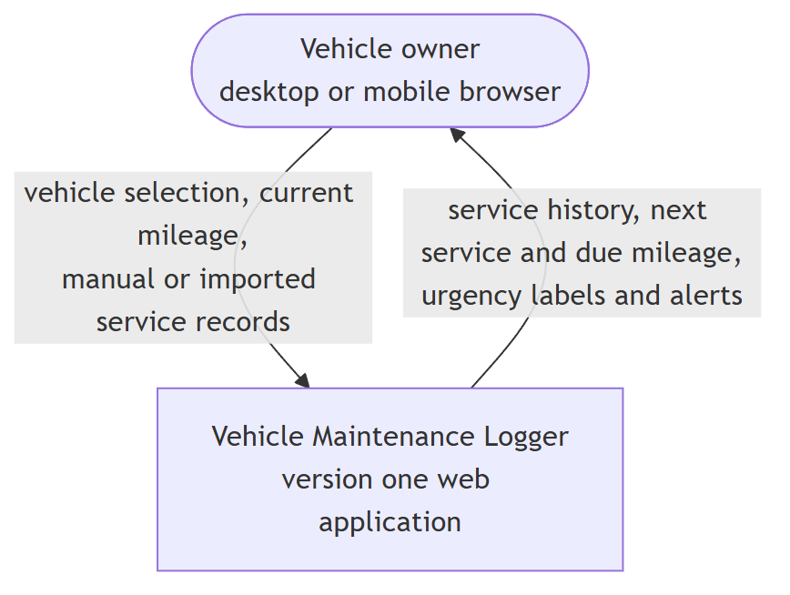
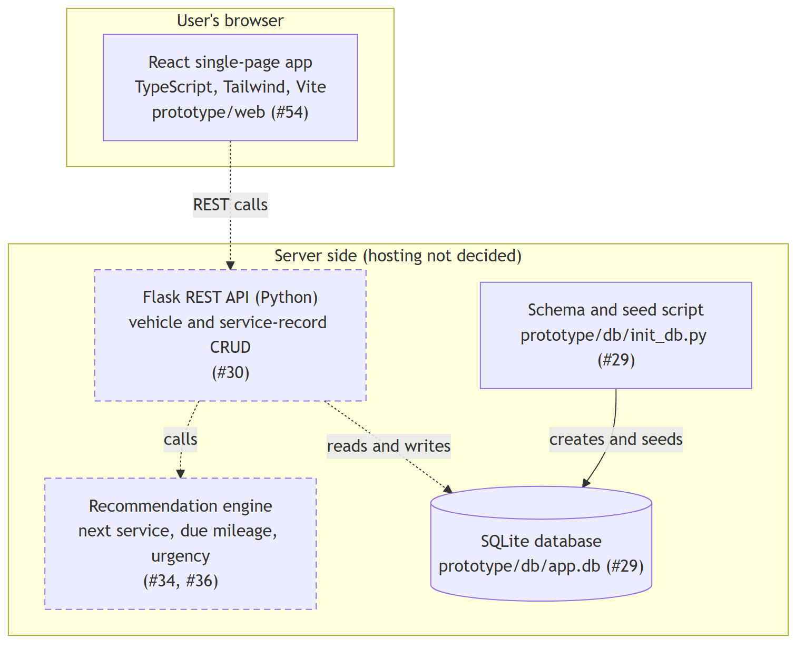

# Design — System context and high-level architecture

> Epic: #27, #28 · Stories: #29, #30, #34, #36 · Task: #51
> Owner: Mathieu Partain-Martinez · Sprint: 2 · Status: draft

## 1. System context

*Figure 1 — System context. This shows where version one ends. The vehicle
owner is the only person outside the system, and we haven't picked any
third-party services yet.*

Source: [`diagrams/system-context.mmd`](diagrams/system-context.mmd)

Figure 1 shows what version one covers and who uses it from the outside.

## 2. High-level architecture

*Figure 2 — High-level architecture. These are the main pieces and how they
fit together. Solid boxes and arrows already have code on an open branch.
Dashed ones are required by one of our objectives but haven't been built yet.*

Source: [`diagrams/architecture.mmd`](diagrams/architecture.mmd)

Figure 2 breaks the system into its main parts: the React front end, the Flask
API, the recommendation engine, and the SQLite database.

## 3. Verification

| Element | Evidence | Status |
|---|---|---|
| Vehicle owner and data exchanged | Proposal §2, Objectives 1.1, 1.3, 2.1, 2.3, 2.4 | required |
| React, TypeScript, Tailwind | Team stack post, Discord, 2026-11-01; `prototype/web/` on `feature/54-prototype-skeleton` | agreed; code on unmerged branch |
| Vite | `prototype/web/` on `feature/54-prototype-skeleton`; not named in the stack post | code on unmerged branch |
| Flask REST API (Python) | Objective 1.2 (#30); team stack post, Discord, 2026-11-01 | agreed; not built |
| Recommendation engine | Objectives 2.1 and 2.3 (#34, #36) | required; not built |
| SQLite | Team stack post, Discord, 2026-11-01; `prototype/db/` in PR #48 | agreed for the prototype; code in unreviewed PR |
| Seed script | `prototype/db/` in PR #48 | code in unreviewed PR |
| API calls engine; only the API touches the database |confirmed | agreed; not built |

## 4. Open decisions

| Decision | Current state | Effect on the diagrams |
|---|---|---|
| Hosting | Still open in the team stack post and the #49 specification | Name goes on the server boundary |
| AI | Proposal §1.1 says AI answers questions about records; Objectives 2.1 to 2.4 do not mention AI | New box and possibly an external actor |
| Maintenance schedule source | Objective 2.3 says "documented" rules; no source named | New data store or external actor |
| Accounts and sign-in | Objective 1.1, the #53 screen flow, and the PR #48 `users` table include them; the #49 specification scopes them out | New component if in scope |

You won't see boxes for automatic mileage tracking, DIY logs, the parts finder,
or climate-based recommendations. Section 2 of the proposal leaves those out
of version one.