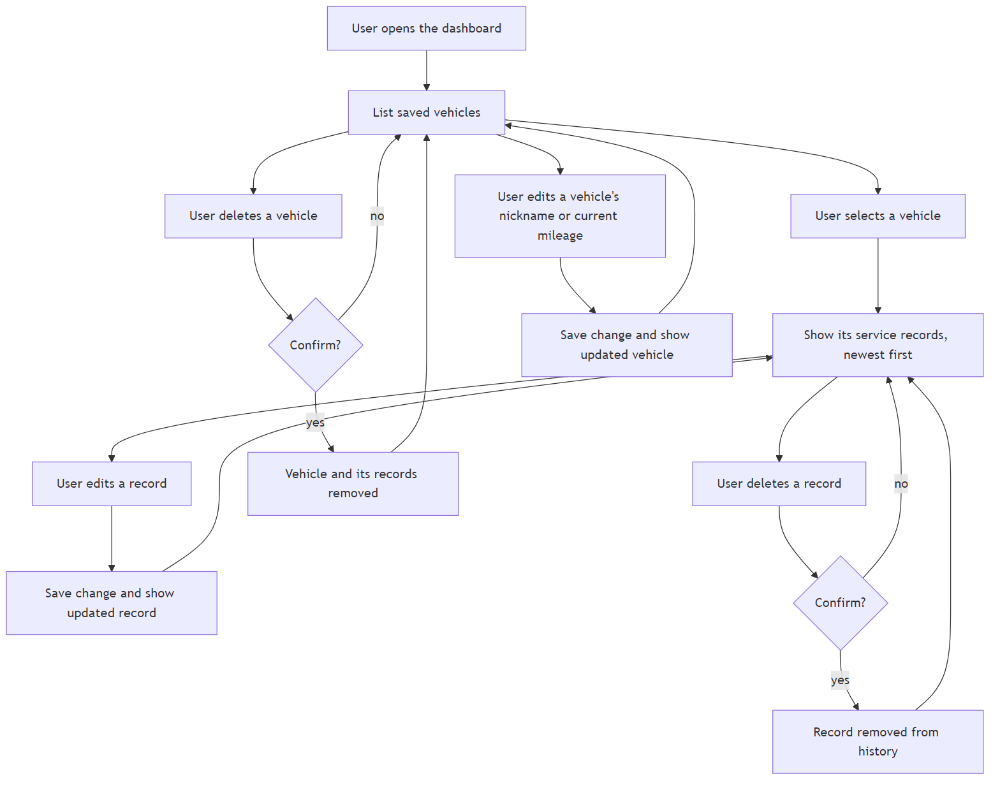

# Design — Maintenance dashboard

> Epic: #27 · Stories: #32
> Owner: Ethan Chien · Sprint: 3 · Status: draft

## Overview

The dashboard is the page where a user sees their saved vehicles and each
vehicle's maintenance history, and manages them: editing a service record,
deleting a service record, or deleting a vehicle. It works on desktop and on a
phone-width screen.

It sits in the flow described in `docs/design/screen-flow.md` (Dashboard
section). This document covers what the dashboard shows and does for #32. It does
not cover the screens around it (vehicle selection, service entry, import).

## Scope

**In scope.**

- Listing the vehicles saved to the demo user's account.
- Showing a selected vehicle's service records, newest first.
- Editing a vehicle's nickname or current mileage, editing a service record,
  deleting a service record, deleting a vehicle.
- Fitting a phone-width screen, with readable text and tappable buttons.

**Out of scope.**

- Status labels and the missing-data prompt (#34, #37; see
  `docs/specs/recommendations-and-alerts.md` FR-6 to FR-9 and FR-13).
- Adding vehicles and service records (#29, #31).
- Sign-in. The page acts as the seeded demo user.

## What the dashboard calls

All of these are defined in `docs/specs/vehicle-service-api.md`.

| Dashboard action | API call |
|---|---|
| Load the vehicle list | `GET /users/{user_id}/vehicles` |
| Select a vehicle | `GET /vehicles/{vehicle_id}/service-records` |
| Save an edited record | `PATCH /service-records/{record_id}` |
| Delete a record | `DELETE /service-records/{record_id}` |
| Save an edited vehicle | `PATCH /vehicles/{vehicle_id}` |
| Delete a vehicle | `DELETE /vehicles/{vehicle_id}` |

## Dashboard flow

*Figure 1 — Dashboard flow. Selecting, editing and deleting each call the API
listed above. Source: `diagrams/maintenance-dashboard.mmd`.*

## Functional requirements

| ID | Requirement | Story |
|---|---|---|
| FR-1 | When the user opens the dashboard, the system shall list every vehicle saved to their account. | #32 |
| FR-2 | When the user selects a vehicle on the dashboard, the system shall show that vehicle's saved service records. | #32 |
| FR-3 | When the dashboard shows a vehicle's service records, the system shall order them newest first. | #32 |
| FR-4 | When the user edits a service record on the dashboard, the system shall save the change and show the updated record. | #32 |
| FR-5 | When the user deletes a service record on the dashboard, the system shall remove it from the vehicle's service history. | #32 |
| FR-6 | When the user deletes a vehicle on the dashboard, the system shall remove the vehicle and all of its service records. | #32 |
| FR-7 | When the user edits a vehicle's nickname or current mileage on the dashboard, the system shall save the change and show the updated vehicle. | #32 |

## Non-functional requirements

| ID | Requirement | Why it matters here |
|---|---|---|
| NFR-1 | While the dashboard is shown on a phone-width screen, the system shall not require horizontal scrolling. | The app is meant to work on mobile browsers; sideways scrolling makes a table hard to read. |
| NFR-2 | While the dashboard is shown on a phone-width screen, the system shall show text and buttons at a size that is readable and easy to tap. | Users cannot use a page whose text they cannot read or whose buttons they miss. |

## Open questions

- **Phone-width numbers.** Neither NFR names a width or a tap-target size, and
  the team has not agreed any. Readability has no measure at all.
