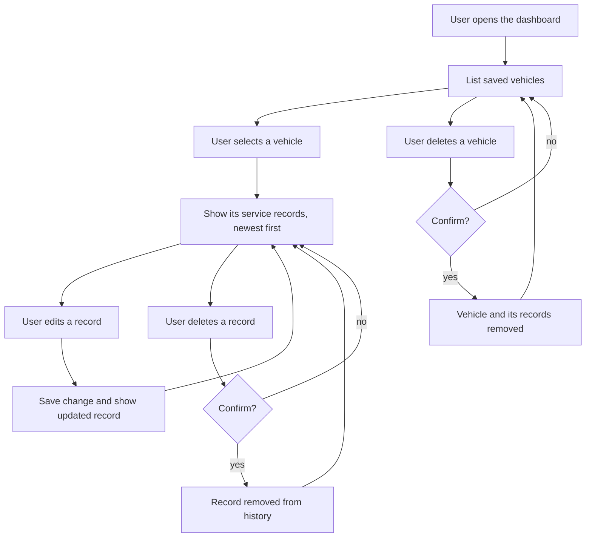

# Design — Maintenance dashboard

> Epic: #27 · Stories: #32
> Owner: Ethan Chien · Sprint: 3 · Status: draft

## Overview

The dashboard is the page where a user sees their saved vehicles and each
vehicle's maintenance history, and manages them: editing a service record,
deleting a service record, or deleting a vehicle. It works on desktop and on a
phone-width screen.

It sits in the flow described in `docs/design/screen-flow.md` (Dashboard
section). This document covers what the dashboard shows and does for #32. It does
not cover the screens around it (vehicle selection, service entry, import).

## Scope

**In scope.**

- Listing the vehicles saved to the demo user's account.
- Showing a selected vehicle's service records, newest first.
- Editing a service record, deleting a service record, deleting a vehicle.
- Fitting a phone-width screen, with readable text and tappable buttons.

**Out of scope.**

- Status labels and the missing-data prompt (#34, #37; see
  `docs/specs/recommendations-and-alerts.md` FR-6 to FR-9 and FR-13).
- Adding vehicles and service records (#29, #31).
- Editing a vehicle's nickname or current mileage from the dashboard. The API
  supports it (`docs/specs/vehicle-service-api.md` FR-10); the dashboard does
  not use it yet.
- Sign-in. The page acts as the seeded demo user.

## What the dashboard calls

All of these are defined in `docs/specs/vehicle-service-api.md`.

| Dashboard action | API call |
|---|---|
| Load the vehicle list | `GET /users/{user_id}/vehicles` |
| Select a vehicle | `GET /vehicles/{vehicle_id}/service-records` |
| Save an edited record | `PATCH /service-records/{record_id}` |
| Delete a record | `DELETE /service-records/{record_id}` |
| Delete a vehicle | `DELETE /vehicles/{vehicle_id}` |

## Dashboard flow

*Figure 1 — Dashboard flow. Selecting, editing and deleting each call the API
listed below.*

## Functional requirements

| ID | Requirement | Story |
|---|---|---|
| FR-1 | When the user opens the dashboard, the system shall list every vehicle saved to their account. | #32 |
| FR-2 | When the user selects a vehicle on the dashboard, the system shall show that vehicle's saved service records. | #32 |
| FR-3 | When the dashboard shows a vehicle's service records, the system shall order them newest first. | #32 |
| FR-4 | When the user edits a service record on the dashboard, the system shall save the change and show the updated record. | #32 |
| FR-5 | When the user deletes a service record on the dashboard, the system shall remove it from the vehicle's service history. | #32 |
| FR-6 | When the user deletes a vehicle on the dashboard, the system shall remove the vehicle and all of its service records. | #32 |

## Non-functional requirements

| ID | Requirement | Why it matters here |
|---|---|---|
| NFR-1 | While the dashboard is shown on a phone-width screen, the system shall not require horizontal scrolling. | The app is meant to work on mobile browsers; sideways scrolling makes a table hard to read. |
| NFR-2 | While the dashboard is shown on a phone-width screen, the system shall show text and buttons at a size that is readable and easy to tap. | Users cannot use a page whose text they cannot read or whose buttons they miss. |

These restate `docs/specs/recommendations-and-alerts.md` NFR-3 and NFR-4. The
criteria give no widths or sizes (see Open questions).

## Acceptance criteria and tests

The criteria are those on #32. The test names are from the open PRs #90, #92
and #102; none of them is merged into `develop` yet, so these tests are not on
`develop` today. The tests are in `prototype/tests/ui/dashboard.test.js` and
`prototype/tests/ui/dashboard-responsive.test.js`, and run against a fake API
server in jsdom.

| # | Criterion | Test |
|---|---|---|
| 1 | When the user opens the dashboard, the system shall list every vehicle saved to their account. | `the dashboard lists every vehicle saved to the demo user's account` |
| 2 | When the user selects a vehicle on the dashboard, the system shall show that vehicle's saved service records. | `selecting a vehicle requests its records and lists them newest first`, `switching vehicles shows the other vehicle's records` |
| 3 | When the dashboard shows a vehicle's service records, the system shall order them newest first. | `selecting a vehicle requests its records and lists them newest first`, `changing a record's date re-sorts the history newest first` |
| 4 | When the user edits a service record on the dashboard, the system shall save the change and show the updated record. | `editing a service record saves it and the table shows the change` |
| 5 | When the user deletes a service record on the dashboard, the system shall remove it from the vehicle's service history. | `deleting a service record after confirming removes it` |
| 6 | When the user deletes a vehicle on the dashboard, the system shall remove the vehicle and all of its service records. | `deleting the selected vehicle removes it and clears its history` |
| 7 | While the dashboard is shown on a phone-width screen, the system shall not require horizontal scrolling. | `at <width>px the page is no wider than the screen (no horizontal scroll)` |
| 8 | While the dashboard is shown on a phone-width screen, the system shall show text and buttons at a size that is readable and easy to tap. | `at <width>px every visible button and field is at least 44px tall`; readability is judged by a person |

## Open questions

- **Phone-width numbers.** The criteria for NFR-1 and NFR-2 do not name a width
  or a size, because the team has not agreed any. The tests use 320, 375 and
  414 px as phone widths and 44 px as the minimum tap-target height. Those
  numbers live in the test, not in the criteria.
- **Readability is not measured.** The tap-target test measures height, not
  whether text is readable. A person has to look at the page at phone width.
- **Vehicle edits.** Whether the dashboard should also edit a vehicle's nickname
  or current mileage is not decided.
- **Overlap with `screen-flow.md`.** That document already describes the
  dashboard's place in the navigation; this one describes its behaviour. Check
  that they do not drift.
- **Tests use a fake server.** They run the page in jsdom, which is not a
  browser, against a stand-in for the API that could drift from the real one.
- **Layout of edit and delete on phones.** PR #102's description says the edit
  and delete controls are not laid out for the card view yet. That has not been
  re-checked after the merges.
