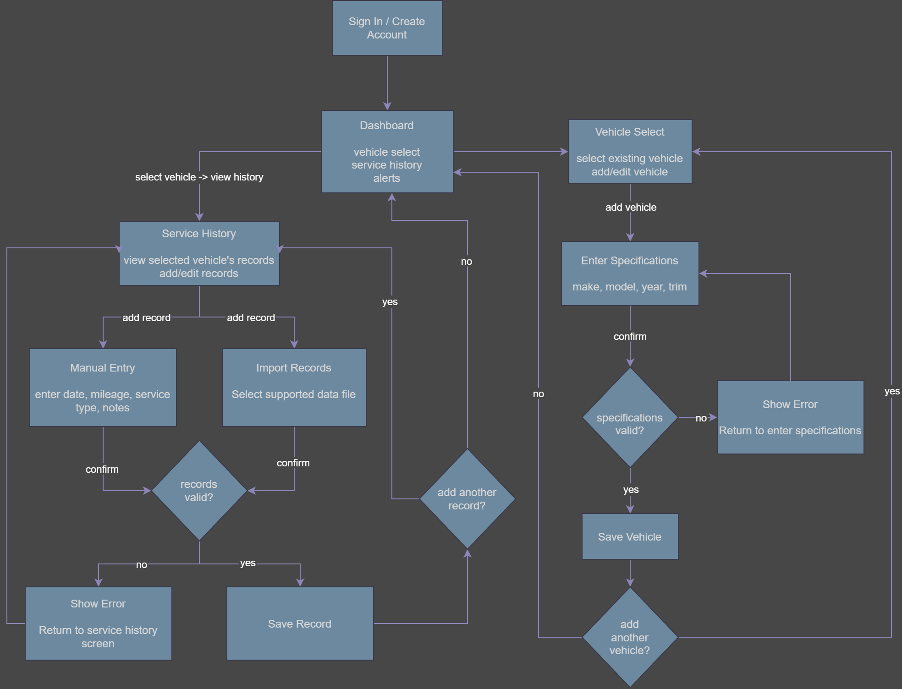

# Dashboard and Service Entry Screen Flow

**Epic:** #27 – Centralized Vehicle Data & Maintenance Tracking  
**Related User Stories:** #29, #31, #32, #34, #36, #37  
**Task:** #53 – Draw Dashboard and Entry Screen Flow

## Purpose

The purpose of the screen-flow diagram is to demonstrate how users navigate between the dashboard, vehicle selection, and service-history screens to manage their vehicle's maintenance records.  It shows the process of accessing the dashboard, selecting or adding a vehicle, and managing maintenance records through manual entry or importing existing data.  

The diagram also illustrates vehicle and service-record validation, error handling, current mileage entry, and maintenance recommendations based on the selected vehicle's information.

## Screen Flow

Figure 1 illustrates the proposed navigation between the dashboard, vehicle management, service-history entry, and maintenance recommendations.

*Figure 1 — Dashboard and service-entry screen flow.*

## Screen Descriptions

### Dashboard
Main page of the application that displays the selected vehicle, service history, and alerts for upcoming maintenance.  Users can navigate to other screens from the dashboard and access the systems features, such as adding or editing a vehicle.

### Vehicle Select
Allows users to manage and view vehicles.  Users may choose an existing vehicle or add/edit vehicle information.  Selecting a vehicle will display that vehicle's associated maintenance records.

### Add New Vehicle
Allows users to enter vehicle details (make, model, year, trim).  The system will validate input before saving.

### Service History
Displays service records associated with selected vehicle.  Users can view existing records and add new service information manually or by importing.

### Manual Entry
Allows users to enter service date, mileage, service type, and notes.  The system will validate input before saving.

### Import Records
Allows users to select existing files of service history records.  The system will validate input before saving. 

### Current Mileage
Allows users to enter or update the current mileage of the selected vehicle.  This information is used to determine upcoming services and calculate maintenance recommendations. 

### Maintenance Recommendations
Displays upcoming services based on vehicles information, current mileage, and previous records.  Recommended services will be displayed as a maintenance status. 

### Maintenance Status
Four maintenance status labels are used to communicate the urgency of upcoming services:

- **When Convenient (green):** The vehicle is before the recommended maintenance window.
- **Due Soon (yellow):** The vehicle is within 500 miles before the recommended maintenance window begins.
- **Due Now (orange):** The vehicle is inside the recommended maintenance window.
- **Overdue (red):** The vehicle has passed the end of the recommended maintenance window.

## Validation and Navigation

### Vehicle Validation

After a user updates an existing vehicle or adds a new vehicle, the system checks whether the information entered is valid.  If the validation succeeds, the vehicle will be saved and/or updated.  If the validation fails, an error message appears and the user returns to the entry screen. 

Users selecting an existing vehicle can proceed directly to the current mileage screen without entering the new vehicle entry screen again.

### Service History Validation

The system validates all records, whether entered manually or imported.  If the validation succeeds, the record is saved and associated with the corresponding vehicle.  If the validation fails, an error message is shown and the user returns to the service history screen.  

Invalid records are not saved.

## Related Requirements

This diagram supports the following project objectives:

## Related Requirements

This diagram supports the following project objectives:

- **Objective 1.1 ([#29](https://github.com/TylerWard741/CPSC490-G09-SigmaSquad/issues/29)):** Vehicle selection and identification using make, model, year, and trim.
- **Objective 1.3 ([#31](https://github.com/TylerWard741/CPSC490-G09-SigmaSquad/issues/31)):** Manual service-history entry, importing existing records, and validating records before saving.
- **Objective 1.4 ([#32](https://github.com/TylerWard741/CPSC490-G09-SigmaSquad/issues/32)):** Dashboard navigation and access to vehicle maintenance history.
- **Objective 2.1 ([#34](https://github.com/TylerWard741/CPSC490-G09-SigmaSquad/issues/34)):** Maintenance recommendations based on vehicle specifications, current mileage, and service history.
- **Objective 2.3 ([#36](https://github.com/TylerWard741/CPSC490-G09-SigmaSquad/issues/36)):** Displaying maintenance urgency labels using documented mileage-based rules.
- **Objective 2.4 ([#37](https://github.com/TylerWard741/CPSC490-G09-SigmaSquad/issues/37)):** Displaying alerts for upcoming or overdue maintenance services.

## Design Status

This diagram represents the proposed user interface and navigation flow for the Vehicle Maintenance Logger. The screens, validation processes, and maintenance recommendations are planned functionality and do not represent completed application features.
