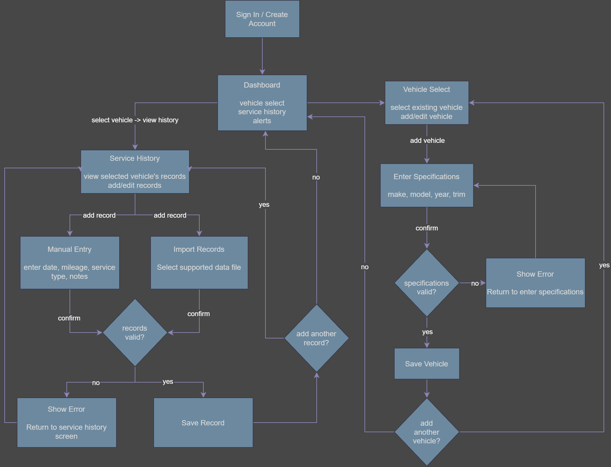
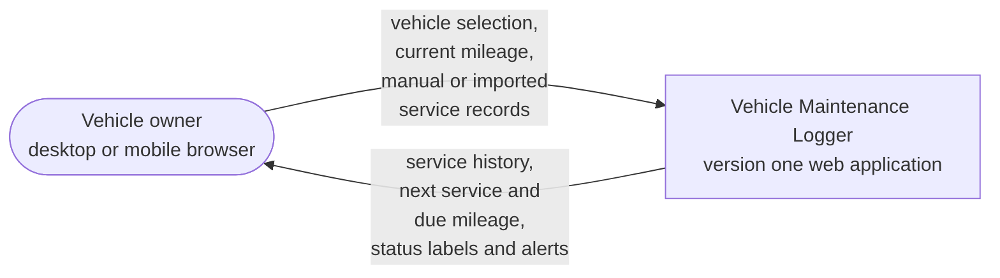
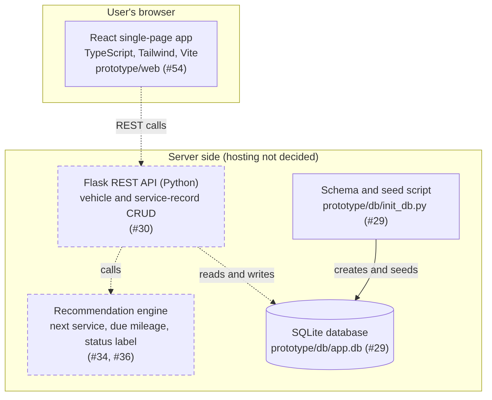
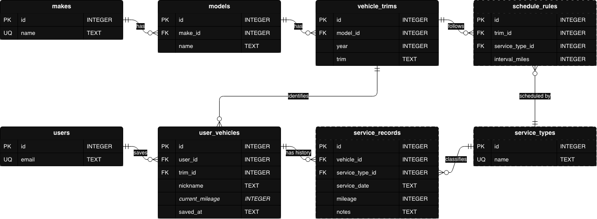
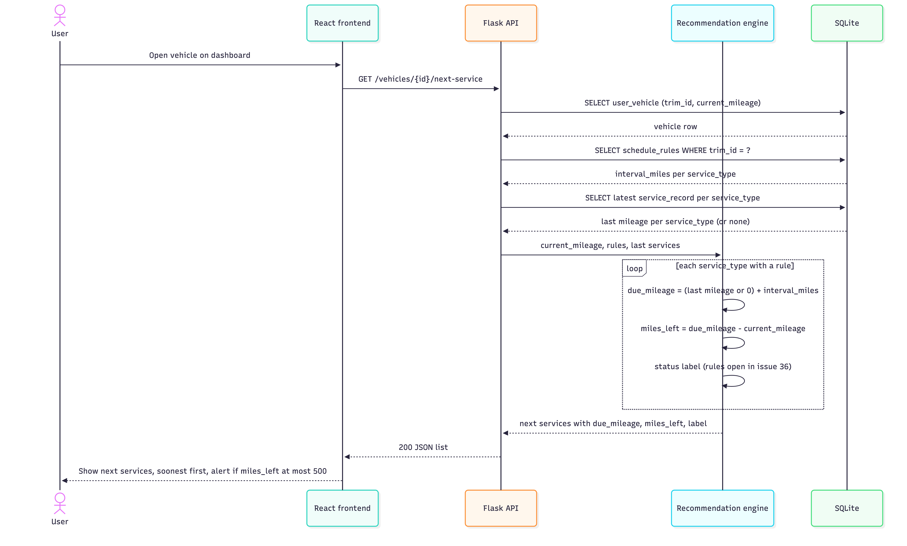
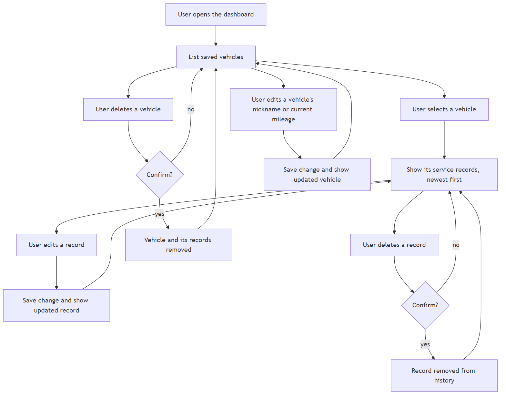

# Project Proposal — Vehicle Maintenance Logger

**Department of Computer Science**
**CPSC 490 Undergraduate Seminar in Computer Science — Proposal for Capstone Project**

**Group 09 — Sigma Squad** · Sponsor: independent

**Authors**:
| Name | Username |
| -- | -- |
|Ward, Tyler|@TylerWard741|
|Partain-Martinez, Mathieu|@Mathieu2303|
|Mojica Arevalo, Hector Samuel|@TamtungOS|
|Chien, Ethan|@ready2pullallnighters|
|Velasco, Emily|@emilyvlsco|
Date: 2026-10-09

---

## 0. Abstract

Vehicle maintenance and car servicing is essential to the reliability and efficiency of a vehicle.  Despite its importance, the process as a whole can be quite overwhelming.  Automakers provide an owner’s manual, but they do not prioritize conciseness, adaptability, and they do not account for the user's ability to interpret it or the user’s automotive knowledge. After years of operation, car owners will accumulate all kinds of receipts, invoices, and documents that detail services that were already completed. These documents need to be manually accounted for to effectively determine service requirements for a vehicle.  
To better manage vehicle maintenance records and provide the most accurate logs for car owners, the project proposed focuses on a vehicle maintenance logger.  The logger will prioritize organization, adaptability, and accuracy, all while maintaining a user friendly system.  Users of the maintenance logger will be able to input vehicle specifications into the system: make, model, year, and existing records. The information will be processed, organized, and used to provide logical recommendations for future services. Automatic mileage tracking, DIY maintenance logs, a parts finder, climate based recommendations, and maintenance reminders are a few of the key features proposed. 
The following proposal will discuss in further detail, the main issue to be solved with current vehicle maintenance processes.  It will examine existing applications and propose a new system with more distinguishing features. The proposal is intended to recommend improvements to already existing features, as well as incorporate newly developed ones. The project's goals and the intended direction for a reliable vehicle management system will also be specifically outlined. 

## 1. Introduction

Background for a non-car person:
With every vehicle, there are slightly different mechanical configurations to the chassis to the engine and everything in between, like the transmission and the drive shaft and the ways that the wheels are connected and the different types of transmission and different types of brakes, like drums versus disc brakes. Every vehicle has a different configuration, and different configurations like this require different care instructions.
In the automotive world, there are several different companies who manufacture different lines of vehicles. These are referred to as manufacturers. When we discuss vehicles, and we reference who made them, we might refer to it as the “make“. When a manufacturer creates a vehicle, they create a specific “model“. For example, many people know the Toyota Prius. In that case, Toyota is the manufacturer and Prius is the name of the model.
If a manufacturer has a lot of success with a certain model, they will usually reproduce it again on some kind of interval, possibly yearly. Each year, the model is updated slightly with new features and improvements. Even with the same model of vehicle from the same manufacturer, differing year productions of it will require different regular maintenance and service from that of its other year models.
The manufacturers lay this all out clearly and specifically in a booklet that always comes with a new vehicle that is called the drivers manual or owner’s manual. The information contained in the manuals goes over a wide range of topics, and one of the topics includes suggested regular maintenance. It usually gives a list or table showing the different services that the vehicle needs and it gives you a number of how many miles the vehicle will need to have its service done after. It might recommend that an oil or oil filter change for a vehicle is done every 3000 miles. The user is expected to perform that service on the vehicle at or before that mileage interval in order to keep the vehicle in proper working order.
The vehicle maintenance logger is an idea for a web app and/or mobile apps that serves as a sort of journal and reminder and logger for an individuals vehicle maintenance.
One of the team member’s current vehicle, a 2010 Chevy Silverado, was sold to him by his grandparents. They were the original owners and from the day they bought the truck, they saved a record of basically everything regarding the truck throughout its life. Every oil change, new tires, damage repair, transmission fluid replacement, etc., everything was all saved.
It was plastic tote bin full of many papers. There are plenty of 8 1/2×11 sized papers, small receipts, pamphlets, the owners manual, other pink and yellow receipt type papers that are odd sizes, all sorts of documents. This is very useful information to have as the buyer of the vehicle, but the amount of documentation is overwhelming. It would take a lot of dedication to sit down and read through it and use it to determine what sort of service to do next on the vehicle and at what mileage. An app that can process these records with minimal human overhead can save a lot of time.
Not having the information to make the appropriate judgment on the vehicle has its consequences. The Chevy’s entire transmission had to be replaced because the fluid was so incredibly bad. If I had transmission fluid check done and flushed way earlier, then I would've saved myself plenty of money on that transmission replacement.
Why this matters:
If one does not change their tires before the tread gets too shallow, they run the risk of losing traction while driving and can end up injuring themselves and other people. If one does not replace their brake pads before they wear too thin, they will lose their stopping power and run the risk of injuring themselves and other people. These sorts of things are more serious and should be taken more seriously.
Anything that gets skipped causes the vehicle to deteriorate in a way that it is not supposed to if the owner had been following the proper maintenance and that deterioration of the vehicle will result in reduction to their safety and their passengers safety, and the safety of other drivers around them, the resale value of the vehicle will go down because people want to buy vehicle vehicles in good condition and will not pay as much for a vehicle and worse condition, and warranties may be voided if regular maintenance that is advised by the manufacturer is not kept up with by the owner.
This would be valuable for so many people because the average person does not keep up with all the regular recommended services of their vehicles to begin with. It's hassle some to keep track of and people don't want to consult the user manual that their car came with to determine which service is needed that which mileage and then keep track of which services they have done and they do not have have any will or desire to memorize the mileage, unless there was a convenient app that did it for them.

### 1.1 Related Work


Vehicle maintenance tracking is a crowded space. We surveyed five currently active products as well as the calendar app that many users use to keep track of maintenance. We compared them on the feature set that applies to our project such as: record keeping with support for import/export, how reminders are triggered and prioritized, AI assistance, platform coverage, and what users get with the free tier.

| Existing approach | What it does | Pros | Cons | Why ours differs |
|---|---|---|---|---|
| CARFAX Car Care [1] - [3] | Using a vehicle's VIN or plate, shows the maintenance schedule recommended by the manufacturer, displays service history by CARFAX network shops, and sends alerts for service or recalls. | Free. Almost no data entry. History can include work done by previous owners | History only populates with CARFAX partnered shop reports. | Ours will allow owners to import records including physical reports and rank upcoming service by urgency. |
| Drivvo [4],[5] | Logs fuel, expenses, income, services, and routes, sends reminders, renders reports and charts, even allows fleet management. Web, iOS, and Android support. | All three major platforms with sync features. Widespread usage. | Free tier has ads. Additional features require a paid plan. Fleet plans are subscription based. Aimed towards fleets and for-hire drivers. | No ads or paid tier. Narrower scope, created for the individual owner rather than fleets. |
| Simply Auto [6]-[8] | Logs fill ups, services, expenses, and trips. Sends reminders based on mileage or date. Automatic trip logging with GPS or Bluetooth. Receipt capture. Cloud sync. | Mileage based reminders in free tier. Automatic trip logging. Low price. | Web access, PDF receipts, ad removal with paid tier. iOS app last updated March 24, 2022. Android app last updated October 10, 2024. Legacy interface. Automatic trip logging limited to 15 trips/month. | Ours will have web access for every user regardless of paid tier status, actively maintained app on all three platforms with support for bulk import of old records. |
| GarageHub [9]-[11], [13], [14] | Maintenance log with photos and costs, parts inventory, to-fix lists, mileage based reminders, and an AI assistant that reads the user's records before replying. Batch receipt scanning with CSV import with a ranked "Up Next" list. Web, iOS, and Android. | AI answers use user's history for context. Mileage based reminders. Bulk history import with reminders ordered by urgency. | Subscription with a limited free tier of 1 vehicle, 50 service logs, and 15 AI messages/month with a 10-entry import cap. Targeted towards hobby mechanics and project cars. | Closest competitor. Our focus is everyday owners, no paid tiers. |
| MECH AI [12] | AI Repair assistant. Vehicle specific chat, OBD2 reading, repair guides, wiring diagrams, and parts search. Saves garage and maintenance history | Most diagnostic potential with repair help. Web, iOS, and Android. | Free tier is limited to 3 AI messages/day. Targeted for just fixing a problem rather than vehicle maintenance. | Our project will use AI to answer questions about owner's records and schedule, supports record-keeping from repairs. |
| Calendar App | Owner estimates a date for every service and reminder. | Free, pre-installed on devices. | Owner must manually log mileage intervals to their calendar by each respective trip date. No service history. | Reminders follow tracked mileage, history lives alongside it. |

Surveying the aforementioned competing products, we primarily focused on two, Drivvo and GarageHub. Drivvo's feature set includes logging, reminders, reports, as well as support for Web, iOS, and Android [4]. GarageHub includes importing old receipts, ranking upcoming service by urgency, even answering service questions from the owner’s own service history, as well as support for Web, iOS, and Android [9], [13], [14]. With multiple competitors already in circulation, our Vehicle Maintenance Logger project isn't unique with GarageHub being the closest competitor. 

Building off of our inspiration to create our own vehicle maintenance logger, our starting point is importing old records into a usable vehicle history. GarageHub offers this, but only the first 10 imported entries are free [13], which a vehicle with a long service history would use up quickly. GarageHub also caps its AI messages [10] with MECH AI having its maintenance schedule locked behind a paid tier [12]. Simply Auto does provide automatic trip detection, however it is limited to 15 trips a month with more locked behind a paid tier [6], and Drivvo shows ads without a subscription [4]. Our application is intended to be the most accessible by vehicle owners wanting to take the initiative of properly maintaining their investment by being free from ads and paid tiers.

MECH AI is another platform for vehicle maintenance, however their focus is for people who work on their own vehicles, similar to GarageHub. GarageHub supports parts inventories and build logs, and MECH AI provides wiring diagrams. As described in Section 1, our users should not have to read the manual cover to cover. They need a guided setup and straightforward answers on what is urgent and what can wait. Another implementation we look for is to provide climate-based recommendations, meaning that our platform would adjust service recommendations to the climate the vehicle is driven in. 

Finally, we seek to provide a platform that would act as a central hub for vehicle owners where record keeping, automatic mileage tracking, DIY service help, and finding parts live in one place. This could be seen as a consolidated platform combining at least two of the products above.

### 1.2 Problem Statements

> Briefly state the problem to solve in this project.

**P1: Maintenance Record Management**

Vehicle maintenance records can be lengthy, disorganized, and spread across various documents. Manually accessing these records can make it difficult to determine a vehicle's maintenance history. Vehicles of different makes, models, years, and trims require different services at different times. 

**P2: Determining Maintenance Requirements and Urgency**

Future vehicle services depend on previous services, a vehicle's specifications, and current mileage. Vehicle owners may have difficulty recognizing which services require immediate action and which services can wait. 

| Problem | Addressed by |
|---|---|
| P1: Maintenance Record Management | G1: Centralized Vehicle Data & Maintenance Tracking |
| P2: Determining Maintenance Requirements and Urgency | G2: Scheduled Maintenance Recommendations & Alerts |

## 2. Goals and Objectives

Features such as automatic mileage tracking, DIY maintenance logs, a parts finder, and climate-based recommendations are not part of the version one scope. We intend to implement these later as stretch goals. This will allow us to keep version one achievable this semester, it allows us to put the core value (due-next maintenance) first, and it allows us more time to research and verify how we should implement these features.

**Goal 1: Centralized Vehicle Data & Maintenance Tracking** (Epic [epic:#27](https://github.com/TylerWard741/CPSC490-G09-SigmaSquad/issues/27))

Enable users to identify their exact vehicle, enter or import its service history, and access accurate maintenance records across desktop and mobile browsers.

**Objectives**

**1.1.** Implement a vehicle database and selection interface that allows users to identify a vehicle by make, model, year, and trim, and save the selected vehicle to their account. ([story:#29](https://github.com/TylerWard741/CPSC490-G09-SigmaSquad/issues/29))

**1.2.** Implement a database schema and REST API supporting create, read, update, and delete (CRUD) operations for vehicles and service records, including service date, mileage, service type, and notes. ([story:#30](https://github.com/TylerWard741/CPSC490-G09-SigmaSquad/issues/30))

**1.3.** Develop an interface that allows users to enter service history manually or import existing service-history data, with imported records validated before being saved. ([story:#31](https://github.com/TylerWard741/CPSC490-G09-SigmaSquad/issues/31))

**1.4.** Build a responsive dashboard that displays each vehicle's maintenance history and supports vehicle and service-record management on desktop and mobile browsers. ([story:#32](https://github.com/TylerWard741/CPSC490-G09-SigmaSquad/issues/32))

**1.5.** Create automated tests covering vehicle selection, service-history entry and import, and maintenance-record API endpoints, with all tests passing in continuous integration (CI). ([story:#33](https://github.com/TylerWard741/CPSC490-G09-SigmaSquad/issues/33))

**Goal 2: Scheduled Maintenance Recommendations & Alerts** (Epic [epic:#28](https://github.com/TylerWard741/CPSC490-G09-SigmaSquad/issues/28))

Provide accurate, mileage-based maintenance recommendations and clearly communicate when maintenance is urgent versus when it can be completed at the user's convenience.

**Objectives**

**2.1.** Develop a recommendation engine that uses the selected vehicle's make, model, year, trim, current mileage, and service history to calculate the next recommended service and its due mileage. ([story:#34](https://github.com/TylerWard741/CPSC490-G09-SigmaSquad/issues/34))

**2.2.** Support next-service recommendations for at least three common service types: oil changes, tire rotations, and brake inspections. ([story:#35](https://github.com/TylerWard741/CPSC490-G09-SigmaSquad/issues/35))

**2.3.** Assign and display an urgency label of either "Urgent" or "When convenient" for each applicable maintenance recommendation, using documented mileage-based rules. ([story:#36](https://github.com/TylerWard741/CPSC490-G09-SigmaSquad/issues/36))

**2.4.** Display dashboard alerts for services that are overdue or within 500 miles of their recommended due mileage, applying the appropriate urgency label. ([story:#37](https://github.com/TylerWard741/CPSC490-G09-SigmaSquad/issues/37))

**2.5.** Validate vehicle selection, service-history processing, due-mileage calculations, and urgency labels against at least five simulated vehicle-data scenarios, with every scenario producing the expected result. ([story:#38](https://github.com/TylerWard741/CPSC490-G09-SigmaSquad/issues/38))

## 3. Proposed Approaches

### Proposed Approach

The team’s approach is to build the recommendation logic around the user’s exact vehicle. The user selects their make, model, year, and trim and enters or imports their service history. That gives one organized record and addresses P1. The backend will then match the vehicle to its recommended service intervals, which come from verified sources such as owner’s manuals and dealer specifications. It compares those intervals against the vehicle’s current mileage and past services to work out when each service is next due. Each recommendation gets one of four status labels, “When Convenient,” “Due Soon,” “Due Now,” or “Overdue,” based on documented mileage rules, so owners can see at a glance what needs attention now and what can wait. This addresses P2. [story:#29](https://github.com/TylerWard741/CPSC490-G09-SigmaSquad/issues/29) [story:#31](https://github.com/TylerWard741/CPSC490-G09-SigmaSquad/issues/31) [story:#35](https://github.com/TylerWard741/CPSC490-G09-SigmaSquad/issues/35) [story:#36](https://github.com/TylerWard741/CPSC490-G09-SigmaSquad/issues/36)

### Alternatives and Trade-offs

**Rule-based vs. AI-generated recommendations.** Competitors like GarageHub and MECH AI use AI to answer service questions. AI is flexible, but its answers can be hard to verify and those features are often behind a paywall. We will be choosing rules built from manufacturer specs because they are predictable, testable, and the information is free. The trade-off is that new vehicles and service types have to be added by hand. [story:#35](https://github.com/TylerWard741/CPSC490-G09-SigmaSquad/issues/35)

**Selecting the status labels.** The team expanded the original two labels to four after considering what the user would need to know about an upcoming service. A service that is approaching its recommended mileage and a service that is already late both need attention, but the owner has a different decision to make in each case. The current specification uses When Convenient when the vehicle is more than 500 miles before the recommended window and Due Soon when the vehicle is within 500 miles of its start. Due Now applies from the start of the window through its end. Once the vehicle passes the end, the service becomes Overdue. [story:#36](https://github.com/TylerWard741/CPSC490-G09-SigmaSquad/issues/36) [task:#59](https://github.com/TylerWard741/CPSC490-G09-SigmaSquad/issues/59)

**Backend framework.** The team selected Python and Flask for the backend after considering Django, FastAPI, and Express. Most of the work that the backend needs to do involves saving a vehicle, retrieving its maintenance history, or using that history to calculate the next service. With Flask, the team can use Python for both the API and the recommendation calculations. Django and FastAPI also support Python, but Flask already met the requirements agreed on for the prototype. Using Express would put the backend in JavaScript while the mileage rules are written in Python. One trade-off with Flask is that the team is responsible for checking the information received from each screen before saving it. [task:#49](https://github.com/TylerWard741/CPSC490-G09-SigmaSquad/issues/49)

**Database.** The prototype uses SQLite to store the vehicle catalog and the maintenance history. SQLite keeps the database in a local file, which makes it practical for team members to work with the same starting set of vehicles on separate computers. PostgreSQL and hosted databases were also considered. Both would require maintaining a database service for the team during development. SQLite is sufficient for a prototype where one user is usually entering records at a time. It only allows one write at a time, so several owners importing their maintenance histories at once would change what the team needs from the database. If the project moves to a hosted database, the saved vehicles and their service records will need to move together. [task:#49](https://github.com/TylerWard741/CPSC490-G09-SigmaSquad/issues/49)

**Frontend.** The team selected React, TypeScript, and Tailwind CSS for the dashboard and service-history screens. A plain HTML and JavaScript page was enough for the initial vehicle selection feature, and the current version of that page still uses TypeScript without React. For the other screens, React allows the team to reuse forms and lists. This is helpful for service history because a vehicle owner should see the same service types and record fields whether they are adding an entry or correcting one on the dashboard. TypeScript helps identify inconsistent data during development. Tailwind CSS supports the desktop and phone layouts. Maintaining a separate vehicle selection page adds some work, but both interfaces use the same backend and saved vehicles. [task:#49](https://github.com/TylerWard741/CPSC490-G09-SigmaSquad/issues/49)

**Hosting.** The hosting platform is still open. The local prototype gives the team a way to demonstrate vehicle selection, service history, and recommendation calculations while that decision is being made. A hosted version will need to run the web application and keep the database available between visits. For example, the records an owner enters before the application is updated should still be available after that update. Whether the host provides persistent storage for SQLite and how many owners are expected to use the service at the same time will affect the decision. The team will also need to address access to individual owners’ histories before making the prototype available as a shared application. [task:#49](https://github.com/TylerWard741/CPSC490-G09-SigmaSquad/issues/49)

The proposed tech stack is explained in §4.

## 4. Required Environment, Resources, and Planned Activities

### 4.1 Development Environment

The Vehicle Maintenance Logger will use a web-based architecture consisting of a frontend interface, backend application, and database. Each component will serve a different purpose in allowing users to manage their vehicles, record maintenance history, and receive recommendations for upcoming services.

The frontend will use React, TypeScript, and Tailwind CSS. React will be used to create the application's user interface.  The interface includes the dashboard, vehicle selection, service-history management, and maintenance recommendations. TypeScript will provide type checking to help identify errors during development and Tailwind CSS will support consistent styling and layouts for both desktop and mobile browsers.

The backend will use Python with the Flask web framework [15]. Flask will handle requests from the frontend, process vehicle and service-history information, validate user input, and support the application's REST API. Python will also be used to implement the logic for determining upcoming maintenance services based on vehicle specifications, current mileage, and previous service records.

SQLite has been selected as the database for the initial prototype. Its role is to store vehicle information, maintenance records, and other data required by the application. This database was chosen for its lightweight and compact nature.  It does not require a separate database server, making it suitable for early development and testing.

The hosting platform has not yet been finalized. Deployment options will be evaluated based on compatibility with the selected technologies and the requirements of the completed application.

| Component | Technology | Purpose |
|---|---|---|
| Frontend | React, TypeScript, Tailwind CSS | Build the dashboard, forms, and user interface |
| Backend | Python, Flask | Handle application logic, REST API requests, and data validation |
| Database | SQLite | Store vehicle information and maintenance records during prototype development |
| Hosting | To be determined | Deploy the application for online access |

### 4.2 Software Tools and Resources

The development of the Vehicle Maintenance Logger will require several software tools to support programming, collaboration, testing, and documentation. The team will use GitHub as the primary platform for managing the project repository, tracking issues, reviewing changes, and organizing development tasks.

Git will be used for version control and allows team members to work on separate branches without directly modifying the main development branch. Changes will be submitted through pull requests targeting the develop branch and every pull request will be reviewed by another team member before merging.  GitHub Actions will also support continuous integration by running automated checks on submitted changes. These checks will help identify problems with repository structure and application functionality.

Visual Studio Code can be used as a development environment for writing and editing application files. Node.js and npm will support the frontend development environment by managing dependencies and development tools for React and TypeScript [16].

For system documentation and design, the team will use various diagramming applications (draw.io, dbdiagram.io, Miro, Excalidraw) to create diagrams illustrating the application's architecture, data relationships, and user navigation. The applications used will vary depending on specific requirements and team member preferences. These diagrams will be stored in the GitHub repository alongside their editable source files.

| Tool | Purpose |
|---|---|
| GitHub | Repository management, issue tracking, pull requests, and collaboration |
| Git | Version control and branch management |
| GitHub Actions | Automated testing and repository validation |
| Visual Studio Code | Writing and editing source code |
| draw.io, dbdiagram.io, Miro, etc. | Creating system architecture and design diagrams |
| Node.js and npm | Frontend dependency management and development |
| Python | Backend programming and application logic |
| Markdown | Writing project documentation and specifications |

### 4.3 Required Skills

The Vehicle Maintenance Logger will require knowledge of frontend development, backend programming, database management, and software testing.

Frontend development skills will be necessary to build the dashboard, vehicle selection interface, and service-history entry screens. Knowledge of React, TypeScript, HTML, and CSS will help the team create an interface that is accessible through both desktop and mobile browsers.

Backend development will require Python programming and familiarity with the Flask framework. These skills will be used to process requests, validate information, manage database operations, and calculate upcoming maintenance recommendations.

Database design skills will be necessary to organize vehicle information and service-history records. The team will need to understand relational databases, data relationships, and create, read, update, and delete operations.

Data validation will also be important because users must be able to manually enter or import existing service records. The application must identify missing or invalid information before saving records.

Finally, testing and debugging skills will help the team verify that the application functions as expected. Git and GitHub knowledge will support collaboration, code reviews, and maintaining an organized development process.

| Required Skill | Application |
|---|---|
| Frontend Development | Creating responsive dashboards, forms, and navigation |
| Python Programming | Implementing backend functionality and maintenance calculations |
| REST API Development | Connecting the frontend and backend |
| Database Design | Organizing vehicles, service records, and related information |
| Data Validation | Checking user input and imported maintenance records |
| Testing and Debugging | Verifying functionality and correcting errors |
| Git and GitHub | Managing collaborative development and pull requests |

### 4.4 System Architecture and Design Diagrams

The Vehicle Maintenance Logger uses a frontend, backend, and database to manage vehicle information and provide maintenance recommendations. The frontend allows users to interact with the application, while the backend processes requests and communicates with the database. [task:#51](https://github.com/TylerWard741/CPSC490-G09-SigmaSquad/issues/51)

The backend uses Python and Flask to process requests from the frontend, validate vehicle and service records, and support maintenance recommendation calculations. SQLite stores vehicle information and maintenance records during prototype development. [task:#51](https://github.com/TylerWard741/CPSC490-G09-SigmaSquad/issues/51) [story:#30](https://github.com/TylerWard741/CPSC490-G09-SigmaSquad/issues/30)

```{=openxml}
<w:p><w:r><w:br w:type="page"/></w:r></w:p>
```

Figure 1 shows the paths a vehicle owner can take from the dashboard. A returning owner can select a saved vehicle and review its history. An owner adding a vehicle or entering service records goes through validation before the new information becomes part of that history. The diagram also shows where mileage entry and maintenance recommendations fit into the planned dashboard. [task:#53](https://github.com/TylerWard741/CPSC490-G09-SigmaSquad/issues/53)

{alt="Dashboard and service-entry screen flow"}

```{=openxml}
<w:p><w:r><w:br w:type="page"/></w:r></w:p>
```

Figure 2 shows the information exchanged with the vehicle owner. The owner supplies the vehicle, mileage, and service records and receives its maintenance history and recommendations. Version one uses no outside services for this exchange. [task:#51](https://github.com/TylerWard741/CPSC490-G09-SigmaSquad/issues/51)

{alt="System context diagram"}

Figure 3 shows how the browser, Flask backend, recommendation engine, and SQLite database work together. The dashed outlines mark parts that were planned when the diagram was drawn. The prototype now includes both the API and the recommendation calculations. [task:#51](https://github.com/TylerWard741/CPSC490-G09-SigmaSquad/issues/51)

{width=5.25in alt="High-level architecture diagram"}

```{=openxml}
<w:p><w:r><w:br w:type="page"/></w:r></w:p>
```

Figure 4 shows how the vehicle catalog, saved vehicles, and maintenance history are related. A make can have several models, and each model can have several years and trims. When an owner saves a vehicle, their service records belong to that saved vehicle. The diagram reflects an earlier version of the database design. The service_types and service_records tables are now part of the prototype. The table shown as schedule_rules was implemented as service_intervals and holds the documented mileage intervals used in recommendations. [task:#52](https://github.com/TylerWard741/CPSC490-G09-SigmaSquad/issues/52) [task:#75](https://github.com/TylerWard741/CPSC490-G09-SigmaSquad/issues/75) [task:#81](https://github.com/TylerWard741/CPSC490-G09-SigmaSquad/issues/81)

{alt="Vehicle catalog, saved vehicles, service records, and the maintenance schedules in the original database design"}

```{=openxml}
<w:p><w:r><w:br w:type="page"/></w:r></w:p>
```

Figure 5 follows a next-service calculation from the dashboard to the database and back. The selected vehicle determines which maintenance schedule applies. The last recorded mileage for each service determines where its next interval begins, and the vehicle’s current mileage determines how close it is to that service. The diagram shows the planned return of the due mileage, distance remaining, and status to the dashboard. The prototype can calculate the window and label. The dashboard alert and its mileage display are still in development. [task:#52](https://github.com/TylerWard741/CPSC490-G09-SigmaSquad/issues/52) [task:#76](https://github.com/TylerWard741/CPSC490-G09-SigmaSquad/issues/76) [task:#117](https://github.com/TylerWard741/CPSC490-G09-SigmaSquad/issues/117) [task:#118](https://github.com/TylerWard741/CPSC490-G09-SigmaSquad/issues/118)

{alt="Sequence Diagram for next-service calculations (user → frontend → API → database, then API → engine → back)"}

### Specification and design documents

**Every specification and design document the team writes is listed here**
with the objective it serves. This section is the index of the project's
technical detail: §3 holds the argument, §4 holds the documents that make it
buildable. CI gate G9 fails if a document exists in `docs/specs/` or
`docs/design/` that this section does not link.

| Document | Kind | Covers | Issues |
|-----------------------------------|------------------|---------------------------------|--------------|
| [docs/design/architecture.md](../docs/design/architecture.md) | design | system context and high-level architecture | #27, #28, #29, #30, #34, #36, #51 |
| [docs/design/screen-flow.md](../docs/design/screen-flow.md) | design | dashboard, vehicle selection, service-history entry and import | #29, #31, #32, #53 |
| [docs/design/maintenance-dashboard.md](../docs/design/maintenance-dashboard.md) | design | what the dashboard shows and does: vehicle list, service history, edit and delete, phone-width layout | #27, #32 |
| [docs/specs/vehicle-service-api.md](../docs/specs/vehicle-service-api.md) | specification | API spec that outlines our database schema and REST API implementation for Creating, Reading, Updating, and Deleting (CRUD) operations for vehicles and service records. | #30 |
| [docs/specs/recommendations-and-alerts.md](../docs/specs/recommendations-and-alerts.md) | specification | Status labels and dashboard for recommended services (epic #28) | #50, #34, #35, #36, #37, #38 |
| [docs/specs/recommendation-engine.md](../docs/specs/recommendation-engine.md) | specification | which service types the recommendation engine supports and the reference data it reads | #28, #35 |
| [docs/specs/vehicle-selection.md](../docs/specs/vehicle-selection.md) | specification | This spec covers choosing a vehicle with its make, model, year and trim, and saving it to an account. | #29 |
| [docs/specs/vehicle-data-and-tracking.md](../docs/specs/vehicle-data-and-tracking.md) | specification | Specification for epic #27: vehicle data upload and tracking, CRUD requirements, and service-history entry/import. | #27, #29, #30, #31, #49 |

### 4.5 Specifications

#### Vehicle data and tracking (epic #27)

The vehicle data and tracking specification covers the first goal of the project, keeping an owner’s maintenance records together. An owner may have several receipts for the same car, with each receipt showing a different service, date, and mileage. The user needs to be able to enter those visits over time and find all of them when the car is selected again. A catalog entry identifies the make, model, year, and trim. The vehicle saved by the owner has its own service history. This allows the same catalog entry to be used by different owners while keeping the work performed on each vehicle separate. The prototype uses a demo account while account creation and sign-in remain outside the scope of this specification. [epic:#27](https://github.com/TylerWard741/CPSC490-G09-SigmaSquad/issues/27) [task:#49](https://github.com/TylerWard741/CPSC490-G09-SigmaSquad/issues/49)

The specification groups its 24 functional requirements around three activities. The first is selecting a vehicle. The make determines which models are available, and the model and year determine which trims the owner can select. The user can save the vehicle once all four selections are complete. If the user returns to an earlier choice, the application clears any later choices that depended on it. A vehicle that has already been saved should appear in the owner’s list without being added a second time. The make and model searches also have a one-second response target on the prototype catalog, since both searches take place before the owner can finish the selection. [story:#29](https://github.com/TylerWard741/CPSC490-G09-SigmaSquad/issues/29) [task:#49](https://github.com/TylerWard741/CPSC490-G09-SigmaSquad/issues/49)

The second activity is managing the saved data. The application needs to distinguish between a change that was saved, an entry that needs a correction, and information that could not be retrieved. For example, if a service date is invalid, the user needs to know which part of the entry to correct. If the database is temporarily unavailable, the user should be able to try again with the same vehicle selected. An empty service history is also a possible result for a newly added car. Reporting an unavailable history as empty could cause a returning owner to enter work that was already recorded. [story:#30](https://github.com/TylerWard741/CPSC490-G09-SigmaSquad/issues/30) [task:#49](https://github.com/TylerWard741/CPSC490-G09-SigmaSquad/issues/49)

The third activity is entering service history, either one visit at a time or by importing existing records. Both methods require a service date, mileage, and service type. Notes are optional so that the owner can include details from the receipt without having to write a description for every service. Accepted records will appear under the selected vehicle after the user confirms the entry or import. An invalid entry should identify the problem before anything is added to the history. To meet the acceptance criteria for this epic, the owner needs to be able to select the correct vehicle, and the application needs to support creating, reading, updating, and deleting vehicles and their records. [epic:#27](https://github.com/TylerWard741/CPSC490-G09-SigmaSquad/issues/27) [story:#30](https://github.com/TylerWard741/CPSC490-G09-SigmaSquad/issues/30) [story:#31](https://github.com/TylerWard741/CPSC490-G09-SigmaSquad/issues/31)

#### Vehicle selection (objective 1.1)

Vehicle selection is the first part of objective 1.1 because the maintenance schedule depends on the vehicle being tracked. Two cars can have the same model name and still have different model years or trims. The selection screen starts with the available makes and displays any vehicles already saved by the user. Choosing a make narrows the list of models. Choosing a model makes the available years visible, and choosing a year makes the available trims visible. For the 2020 Toyota Camry in the prototype, the final choice is between the LE and SE trims. The owner can identify the vehicle using the information they know about their car. [story:#29](https://github.com/TylerWard741/CPSC490-G09-SigmaSquad/issues/29)

The make and model lists can both be searched by entering part of a name. The search works regardless of capitalization. Filtering a list helps the user locate an option while keeping the rest of the selection intact. Changing a make or model has a different effect because previous selections may no longer describe a valid car. For example, a user who switches from a Toyota to a Honda should then see Honda models. Any Camry trim chosen earlier needs to be cleared. Save remains unavailable until the new selection is complete. The table shows what happens if the user changes cars partway through the process. [story:#29](https://github.com/TylerWard741/CPSC490-G09-SigmaSquad/issues/29)

| Owner's action | Choices the page keeps | Next action available |
|---------------------------|----------------------|------------------------------------------|
| Opens Vehicle Select | No catalog choice yet | Choose a make or filter the make list. |
| Picks Toyota, then Camry | Toyota and Camry | Choose a year available for the Camry. |
| Picks 2020, then SE | Toyota, Camry, 2020, SE | Save this vehicle. |
| Changes the make to Honda before saving | Honda only | Choose a Honda model. Save is disabled again. |
| Retries after the model request fails | Honda | Reload the Honda model list. The owner can continue from that choice. |

Once the vehicle is saved, it appears in the owner’s list and remains there on a later visit. The application uses the selected trim to identify its make, model, and year. It also checks whether the user has already saved that trim. If the owner presses Save again after seeing a confirmation, the page reports that the vehicle is already on the account. If the database cannot be reached, the page keeps the choices the user made and offers Retry. This is especially important near the end of the process because a temporary failure should not require the owner to start again at the make list. [story:#29](https://github.com/TylerWard741/CPSC490-G09-SigmaSquad/issues/29)

The selection specification has eleven acceptance criteria. Some concern the contents of the catalog, such as whether both 2020 Camry trims are available. Others concern what the screen actually allows, such as whether the owner can save before selecting a trim. The team checks both behaviors. The page checks use a simulated server, and the search checks use the five trims supplied with the prototype. The one-second target applies to that catalog. Performance with a larger catalog and a network connection still needs to be established before the team can make the same claim for a hosted version. [story:#29](https://github.com/TylerWard741/CPSC490-G09-SigmaSquad/issues/29)

The prototype associates selections with the demo user. Saved vehicles remain available when the application is reopened using the same database. Rebuilding the demonstration database replaces the saved vehicles along with the catalog, so a fresh setup has a different purpose from an ordinary return visit. The original vehicle selection feature only allowed the user to add and list vehicles. The dashboard now also allows the owner to remove a saved vehicle. This provides a way to correct a mistaken trim selection after it has already been saved. [story:#29](https://github.com/TylerWard741/CPSC490-G09-SigmaSquad/issues/29) [story:#32](https://github.com/TylerWard741/CPSC490-G09-SigmaSquad/issues/32)

#### Vehicle and service-record API (objective 1.2)

Objective 1.2 covers the vehicle and service-record API used by the dashboard and service-entry screens. It allows the application to create, read, update, and delete a saved vehicle or an individual service record. When a user changes a service date, the correction needs to apply to that particular visit on that particular car. This matters when the user has more than one car, or when a single car has several records for the same type of service. The relationships in Figure 4 keep the receipt attached to the owner’s saved vehicle even if its date, mileage, or notes are corrected later. [story:#30](https://github.com/TylerWard741/CPSC490-G09-SigmaSquad/issues/30) [task:#81](https://github.com/TylerWard741/CPSC490-G09-SigmaSquad/issues/81)

The specification distinguishes the vehicle’s current mileage from the mileage recorded for a past service. Current mileage describes how far the car has traveled as of the latest reading. The mileage on a service record describes how far it had traveled when that work was performed. A new vehicle can be saved before the user has a current reading. Each maintenance entry, however, requires the mileage at the time of the service. The same three service types are available for both manual entry and import. This keeps an oil change entered from a receipt in the same category as an oil change imported from a spreadsheet. [story:#30](https://github.com/TylerWard741/CPSC490-G09-SigmaSquad/issues/30) [task:#81](https://github.com/TylerWard741/CPSC490-G09-SigmaSquad/issues/81)

Vehicle management and record management have different effects on the owner’s history. An owner may update the current mileage, change a nickname, or remove the saved vehicle. Removing a vehicle also removes the history attached to it. Removing one service record leaves the vehicle and its other visits in place. The owner can also retrieve a particular record to review or correct it. When the full history is requested, the application lists the records by service date, with the most recent visit first. An older receipt added later therefore appears in the position corresponding to when the maintenance took place. [story:#30](https://github.com/TylerWard741/CPSC490-G09-SigmaSquad/issues/30) [task:#81](https://github.com/TylerWard741/CPSC490-G09-SigmaSquad/issues/81)

The service-record requirements cover the information the application will accept. A date must be a real calendar date and cannot be in the future. Mileage must be a whole number of zero or more, and the service type must be one the application supports. Notes may contain up to 1,000 characters. A vehicle nickname may contain up to 100. These checks apply regardless of how the record was submitted. If a user enters February 30, the application identifies the date as the problem and leaves the history as it was. If a user corrects just the date on an existing entry, the mileage, service type, and notes on that receipt should remain as originally entered. [story:#30](https://github.com/TylerWard741/CPSC490-G09-SigmaSquad/issues/30) [task:#81](https://github.com/TylerWard741/CPSC490-G09-SigmaSquad/issues/81)

One of the thirteen functional requirements concerns what happens when a receipt provides a more recent odometer reading than the one saved for the vehicle. For example, if the current reading is 42,000 miles and the owner enters a service performed at 42,150 miles, saving that record also raises the current mileage to 42,150. If the owner then finds an earlier receipt from 38,000 miles, the earlier service joins the history while the current mileage stays at 42,150. The same rule applies when a service record is corrected. This allows users to enter a collection of receipts in any order without moving the current odometer reading backward. [story:#30](https://github.com/TylerWard741/CPSC490-G09-SigmaSquad/issues/30) [task:#81](https://github.com/TylerWard741/CPSC490-G09-SigmaSquad/issues/81)

The order of events is also important when the owner corrects a mistake. If an oil change appears under the wrong date, the owner should be able to correct the date without creating another oil-change record. Both copies would otherwise appear in the history, and it would be unclear which one describes the actual visit. If a genuinely separate service was performed at the same visit, it can be recorded under its own service type. This preserves the distinction between correcting an existing oil change and recording a brake inspection completed by the shop on the same day. [story:#30](https://github.com/TylerWard741/CPSC490-G09-SigmaSquad/issues/30) [task:#81](https://github.com/TylerWard741/CPSC490-G09-SigmaSquad/issues/81)

There are two limitations the team needs to address before expanding vehicle management. The duplicate check prevents the same user from saving two cars of the same make, model, year, and trim. This works for a repeated click on Save, but an owner could actually have two identical cars with separate mileage readings and maintenance histories. The other limitation concerns access to those records. The local prototype assumes a demo user. A version shared by several owners will need to verify which vehicles belong to each person when they view, change, or delete a record. [story:#30](https://github.com/TylerWard741/CPSC490-G09-SigmaSquad/issues/30) [task:#81](https://github.com/TylerWard741/CPSC490-G09-SigmaSquad/issues/81)

#### Recommendations and alerts (epic #28)

The recommendations and alerts specification covers how the application will communicate upcoming maintenance to the owner. Version one uses the current mileage entered by the user, the vehicle’s service history, and the documented maintenance schedule. Each supported service has a recommended mileage window when the manufacturer provides an interval for that vehicle. A window can be a range or a single mileage. When the manufacturer gives one mileage, the start and end of the window have the same value. This allows the team to apply the same four status labels to both kinds of recommendation. [epic:#28](https://github.com/TylerWard741/CPSC490-G09-SigmaSquad/issues/28) [story:#34](https://github.com/TylerWard741/CPSC490-G09-SigmaSquad/issues/34) [task:#50](https://github.com/TylerWard741/CPSC490-G09-SigmaSquad/issues/50)

The status depends on where the current reading falls in relation to the window. Consider a service with a recommended range from 30,000 to 31,000 miles. At 29,499 miles, the vehicle is more than 500 miles from the start and the service is When Convenient. At 29,500 miles the status becomes Due Soon. It remains Due Soon through 29,999 miles. The service is Due Now from 30,000 through 31,000 miles, including both ends of the window. At 31,001 miles it is Overdue. If the recommendation were for exactly 30,000 miles, only a reading of 30,000 would be Due Now. The next mile would already be past the recommended point. [story:#36](https://github.com/TylerWard741/CPSC490-G09-SigmaSquad/issues/36) [task:#59](https://github.com/TylerWard741/CPSC490-G09-SigmaSquad/issues/59)

The planned dashboard will show Due Soon, Due Now, and Overdue services. When Convenient is calculated but left off the alert list so the user can focus on the work that is approaching or has already passed its recommended mileage. For Due Soon and Due Now, the display will include the service name, the status, the recommended window, and the number of miles remaining until the end of the window. In the example above, a car at 29,500 miles is 500 miles from the start and 1,500 miles from the end. For an overdue service, the dashboard will show how far the user has driven beyond the end. The dashboard requirements were updated to include all four labels. [story:#37](https://github.com/TylerWard741/CPSC490-G09-SigmaSquad/issues/37) [task:#115](https://github.com/TylerWard741/CPSC490-G09-SigmaSquad/issues/115)

Each label also has a color. Overdue is red, Due Now is orange, Due Soon is yellow, and When Convenient is green. The status will appear in words wherever a label is displayed so that the owner can still distinguish the statuses when the colors are difficult to see. On a phone, the alerts should fit the width of the screen and allow the owner to scroll vertically. The service name, mileage information, and status need to remain readable together. Objective 2.5 calls for five simulated vehicle scenarios to check whether the application produces the expected results. [epic:#28](https://github.com/TylerWard741/CPSC490-G09-SigmaSquad/issues/28) [story:#37](https://github.com/TylerWard741/CPSC490-G09-SigmaSquad/issues/37) [story:#38](https://github.com/TylerWard741/CPSC490-G09-SigmaSquad/issues/38) [task:#115](https://github.com/TylerWard741/CPSC490-G09-SigmaSquad/issues/115)

Entering a new odometer reading replaces the previous reading and recalculates the eligible services. An owner may drive past the recommended mileage between two visits to the dashboard without having added a new service record. On the other hand, a vehicle with no recorded mileage should prompt the owner for that information. The specification also covers prompts for a missing vehicle or service history. One question that remains is how much history is sufficient when the owner has receipts for only some of the supported services. Another is what evidence the team will require when adding a new maintenance interval to the catalog. Version one covers alerts within the web application. Notifications, automatic mileage tracking, and support for multiple drivers remain outside its scope. [epic:#28](https://github.com/TylerWard741/CPSC490-G09-SigmaSquad/issues/28) [story:#34](https://github.com/TylerWard741/CPSC490-G09-SigmaSquad/issues/34) [task:#50](https://github.com/TylerWard741/CPSC490-G09-SigmaSquad/issues/50)

#### Recommendation engine (objective 2.2)

The recommendation engine supports oil changes, tire rotations, and brake inspections. These services are tracked separately because each has its own maintenance interval and service history. Having the tires rotated gives the application a new mileage to use for the next tire rotation. The last oil-change mileage still comes from the most recent oil-change record. For each supported service, the engine uses the selected vehicle’s trim, the relevant history, and the current odometer reading to determine its recommended window and status. The dashboard requirements then determine which of those results are shown to the owner. [story:#35](https://github.com/TylerWard741/CPSC490-G09-SigmaSquad/issues/35) [task:#76](https://github.com/TylerWard741/CPSC490-G09-SigmaSquad/issues/76)

A service schedule and a maintenance history answer different questions. The schedule gives the team a basis for deciding when a service is recommended for a particular vehicle. The history tells the application when that owner last had the work done. A receipt might show that the user waited longer than the recommended interval between their last two oil changes. The application will still use the documented interval when calculating the next oil change. Otherwise, the owner’s delay would become the basis for the next recommendation even though the manufacturer’s schedule had not changed. [story:#35](https://github.com/TylerWard741/CPSC490-G09-SigmaSquad/issues/35) [task:#75](https://github.com/TylerWard741/CPSC490-G09-SigmaSquad/issues/75) [task:#76](https://github.com/TylerWard741/CPSC490-G09-SigmaSquad/issues/76)

The stored interval information includes the vehicle trim, service type, start and end mileage, and distance between repeat services. The team also records the manufacturer’s source, page, and supporting passage for the interval. If a recommendation is questioned later, the team can check the number against the publication it came from. The prototype includes documented intervals for the Toyota Camry and Corolla trims in its catalog. For the Honda Civic trims, the team has not confirmed a fixed mileage interval under Honda’s Maintenance Minder system. An owner can still save a Civic and record work performed on it, but a service without a documented interval will have no mileage-based label. [story:#35](https://github.com/TylerWard741/CPSC490-G09-SigmaSquad/issues/35) [task:#75](https://github.com/TylerWard741/CPSC490-G09-SigmaSquad/issues/75)

For a recurring service, the engine adds the repeat interval to the last mileage recorded for that type of work. A tire rotation performed at 24,800 miles with a repeat interval of 5,000 miles gives a next recommended mileage of 29,800. A vehicle at 29,300 miles is therefore within 500 miles of that service and receives the Due Soon label. When the manufacturer gives a range, the next window retains the width of that range. Completing a service early or late can change the starting point for the next occurrence because the calculation uses the mileage at which the work was actually performed. [story:#35](https://github.com/TylerWard741/CPSC490-G09-SigmaSquad/issues/35) [task:#75](https://github.com/TylerWard741/CPSC490-G09-SigmaSquad/issues/75) [task:#76](https://github.com/TylerWard741/CPSC490-G09-SigmaSquad/issues/76)

The table shows how different services can have the same next recommended mileage for different reasons. The example vehicle is a Camry with 16,000 miles. Its history includes tire rotations at 5,000 and 15,000 miles and an oil change at 10,000 miles. The more recent rotation determines the next tire service. The oil change has a longer interval and reaches the same next mileage from a different receipt. No brake inspection has been recorded for this vehicle. [story:#35](https://github.com/TylerWard741/CPSC490-G09-SigmaSquad/issues/35) [task:#76](https://github.com/TylerWard741/CPSC490-G09-SigmaSquad/issues/76)

| Service | History used by the engine | Next window, miles | Label at 16,000 miles |
|--------------------|-----------------------------|-----------------------|-------------------------|
| Tire rotation | Latest rotation at 15,000 miles | 20,000–20,000 | When Convenient |
| Oil change | Oil change at 10,000 miles | 20,000–20,000 | When Convenient |
| Brake inspection | First window from zero | 5,000–5,000 | Overdue |

The brake inspection illustrates an open question about incomplete history. When a service type has no previous record, the current calculation uses the manufacturer’s first window measured from an odometer reading of zero. That explains the Overdue result in the table. An owner who bought a used car, however, may simply be missing a receipt for work that was completed before the purchase. The engine specification defines the case where history is available. The team still needs to decide how the dashboard should present a first-window result when the user cannot confirm whether that service was previously performed. [story:#34](https://github.com/TylerWard741/CPSC490-G09-SigmaSquad/issues/34) [story:#35](https://github.com/TylerWard741/CPSC490-G09-SigmaSquad/issues/35) [task:#76](https://github.com/TylerWard741/CPSC490-G09-SigmaSquad/issues/76)

### 4.6 Design

#### System context and architecture

The design in Figures 2 and 3 places responsibility for entering vehicle information with the owner. For the first version, the user will select the vehicle, enter the current mileage, and enter or import the records they already have. This keeps the maintenance history useful even when a repair shop does not share records with the application. It also means the recommendations depend on the information the owner supplies. A receipt can establish that an oil change took place at a certain mileage, but the application will still need a current reading to determine how close the car is to the next one. [task:#51](https://github.com/TylerWard741/CPSC490-G09-SigmaSquad/issues/51) [epic:#27](https://github.com/TylerWard741/CPSC490-G09-SigmaSquad/issues/27) [epic:#28](https://github.com/TylerWard741/CPSC490-G09-SigmaSquad/issues/28)

One reason for using mileage is that two owners can have the same car and very different driving habits. An owner who uses a car for a long commute may reach the next rotation several months before someone who only drives on weekends. Both vehicles can use the same documented interval, while their service records and odometer readings give them different recommendations. The owner enters the mileage whenever there is a new reading to report. Since version one does not automatically track driving, the status shown applies to the most recent mileage the owner has entered or recorded through a service visit. [story:#34](https://github.com/TylerWard741/CPSC490-G09-SigmaSquad/issues/34) [story:#36](https://github.com/TylerWard741/CPSC490-G09-SigmaSquad/issues/36) [task:#51](https://github.com/TylerWard741/CPSC490-G09-SigmaSquad/issues/51)

The team chose to keep the maintenance calculations on the backend. A user may record work from a desktop browser and check the same car later on a phone. Both views should use the same interval, the same history, and the same rules for assigning a label. The browser is responsible for displaying the selected vehicle and accepting the owner’s input. The backend is responsible for checking the information and retrieving the records used in the calculation. With one set of rules for all screens, changing the layout of the dashboard does not require changing the way a service becomes Due Soon or Overdue. [task:#51](https://github.com/TylerWard741/CPSC490-G09-SigmaSquad/issues/51) [epic:#27](https://github.com/TylerWard741/CPSC490-G09-SigmaSquad/issues/27) [epic:#28](https://github.com/TylerWard741/CPSC490-G09-SigmaSquad/issues/28)

The same design applies to data entered by different methods. A user who imports an oil-change record and a user who enters the same information manually should end up with equivalent entries in their maintenance histories. Both records need a valid date, mileage, and supported service type. Both belong to the vehicle selected at the time of entry. Keeping the backend responsible for storage allows the dashboard to display the records together in date order regardless of where they came from. This supports the project’s goal of giving the owner one history that can include work completed by different shops or by the owner. [task:#51](https://github.com/TylerWard741/CPSC490-G09-SigmaSquad/issues/51) [epic:#27](https://github.com/TylerWard741/CPSC490-G09-SigmaSquad/issues/27) [story:#31](https://github.com/TylerWard741/CPSC490-G09-SigmaSquad/issues/31)

The architecture document records the team decisions and the project work that supports them. The stack agreed on in November established which tools would be used for the browser interface, the backend, and the prototype database. The objectives establish what those parts need to accomplish. The database and service-history work now provide a working base for the recommendation features, while the complete dashboard alert remains in development. Hosting, access to individual accounts, and sources for additional maintenance schedules are still open decisions. A possible AI feature for answering questions about the owner’s records would also need a separate design. Automatic mileage tracking, a parts finder, separate DIY logs, and climate-based recommendations are outside the first version. [task:#51](https://github.com/TylerWard741/CPSC490-G09-SigmaSquad/issues/51) [epic:#27](https://github.com/TylerWard741/CPSC490-G09-SigmaSquad/issues/27) [epic:#28](https://github.com/TylerWard741/CPSC490-G09-SigmaSquad/issues/28)

#### Dashboard and service-entry screen flow

The screen flow in Figure 1 supports two common visits to the application. The first is when an owner is setting up a car for the first time. The user goes from the dashboard to vehicle selection, adds the make, model, year, and trim, and saves the car after the selection is complete. The second is a return visit, when the owner already has the car saved and needs to add a service or check the mileage. In that case, selecting the existing vehicle takes the user to the information for that car without repeating the original setup. These paths support vehicle selection under objective 1.1 and access to saved maintenance history under objective 1.4. [task:#53](https://github.com/TylerWard741/CPSC490-G09-SigmaSquad/issues/53) [story:#29](https://github.com/TylerWard741/CPSC490-G09-SigmaSquad/issues/29) [story:#32](https://github.com/TylerWard741/CPSC490-G09-SigmaSquad/issues/32)

From the service-history screen, the owner can either enter one visit or import several records. Manual entry is intended for a receipt or service the user wants to record individually. The user enters the date and mileage, chooses the type of service, and can include notes about the work. Import is intended for an owner who already has multiple records in a spreadsheet. Both paths use the selected car and lead back to its history. The owner should be able to see the accepted visits alongside records that were already there. That final step allows the user to check that the right service was added to the right vehicle. [task:#53](https://github.com/TylerWard741/CPSC490-G09-SigmaSquad/issues/53) [story:#31](https://github.com/TylerWard741/CPSC490-G09-SigmaSquad/issues/31)

The validation steps in the flow address mistakes before they become part of the saved history. If a new vehicle selection is incomplete, the owner finishes the selection before it is added to the dashboard. If a service date is invalid or the mileage is missing, the application identifies the problem with the entry. For an imported file, the message also needs to identify the affected row so the user can find it among the other receipts. Successful rows can be confirmed and saved. The owner should be able to tell which visits are in the history and which still need attention before trying the import again. [task:#53](https://github.com/TylerWard741/CPSC490-G09-SigmaSquad/issues/53) [story:#31](https://github.com/TylerWard741/CPSC490-G09-SigmaSquad/issues/31)

Current mileage provides a separate path from service entry. An owner may drive several hundred miles after the last oil change without having any new maintenance to record. Updating the odometer gives the application what it needs to recalculate how far the car is from the next service. The planned recommendations screen uses the vehicle, history, and current reading to identify upcoming work. The maintenance status then indicates how close the owner is to the recommended window. Vehicle selection, manual entry, import, and the history dashboard have been implemented. The dashboard alerts and the display of miles remaining or overdue are still being developed under objectives 2.3 and 2.4. [task:#53](https://github.com/TylerWard741/CPSC490-G09-SigmaSquad/issues/53) [story:#34](https://github.com/TylerWard741/CPSC490-G09-SigmaSquad/issues/34) [story:#36](https://github.com/TylerWard741/CPSC490-G09-SigmaSquad/issues/36) [story:#37](https://github.com/TylerWard741/CPSC490-G09-SigmaSquad/issues/37) [task:#117](https://github.com/TylerWard741/CPSC490-G09-SigmaSquad/issues/117) [task:#118](https://github.com/TylerWard741/CPSC490-G09-SigmaSquad/issues/118)

```{=openxml}
<w:p><w:r><w:br w:type="page"/></w:r></w:p>
```

#### Maintenance dashboard

The maintenance dashboard allows the user to review work that has already been performed on a saved vehicle. When the owner selects a car from the list, the dashboard displays that vehicle’s service records with the newest service date first. This ordering matters when an owner enters older receipts after adding a recent visit. An oil change from March belongs below an inspection from June even if the March receipt was entered last. Figure 6 shows how the owner moves from the vehicle list to the selected history and which changes can be made from each part of the dashboard. [story:#32](https://github.com/TylerWard741/CPSC490-G09-SigmaSquad/issues/32) [task:#77](https://github.com/TylerWard741/CPSC490-G09-SigmaSquad/issues/77)

{alt="Maintenance dashboard flow for selecting a saved vehicle and managing its history"}

The design covers seven actions. The first three are listing the saved vehicles, selecting one, and displaying its records in date order. The remaining actions allow the owner to edit or remove a service record, delete a vehicle, or update its nickname or mileage. Editing a nickname makes a car easier to recognize in the list. Updating its mileage affects the maintenance calculation, so the new reading also needs to be reflected when the user returns to the history. The prototype supports current mileage and the record-management actions. The backend supports nickname changes, but the dashboard still needs a control for the owner to make that change. [story:#32](https://github.com/TylerWard741/CPSC490-G09-SigmaSquad/issues/32) [task:#77](https://github.com/TylerWard741/CPSC490-G09-SigmaSquad/issues/77) [task:#79](https://github.com/TylerWard741/CPSC490-G09-SigmaSquad/issues/79) [task:#125](https://github.com/TylerWard741/CPSC490-G09-SigmaSquad/issues/125)

When correcting a service record, the user should be able to change the field that was entered incorrectly and see the updated visit in the history. If the service date changes, the entry may move to another position in the list. The notes and any other fields the user did not edit should stay with that receipt. If the owner cancels, the original record should remain visible. A rejected change also needs to be clear to the user so they can correct the entry before leaving the page. These behaviors matter when an owner relies on the history to tell a shop which services have already been performed. [story:#32](https://github.com/TylerWard741/CPSC490-G09-SigmaSquad/issues/32) [task:#79](https://github.com/TylerWard741/CPSC490-G09-SigmaSquad/issues/79)

Deleting a record and deleting a vehicle have different consequences. Removing an incorrect receipt should leave the rest of the vehicle’s service history available. Removing the saved vehicle also removes the records attached to that car. The dashboard requests confirmation before deleting and updates the vehicle list or history after the change. If the last receipt is removed, the owner should see that the vehicle now has an empty history. If the database is temporarily unavailable, the dashboard should report that the history could not be loaded and provide a way to retry. Otherwise, the owner could mistake a storage problem for a loss of service records. [story:#32](https://github.com/TylerWard741/CPSC490-G09-SigmaSquad/issues/32) [task:#77](https://github.com/TylerWard741/CPSC490-G09-SigmaSquad/issues/77) [task:#79](https://github.com/TylerWard741/CPSC490-G09-SigmaSquad/issues/79)

The dashboard also needs to be usable at phone width. On a desktop, the service date, mileage, service type, notes, and actions can be placed across one row. On a phone, a long note can take up most of that width before the owner reaches the controls. The prototype stacks the fields for each visit so that the user can scroll vertically and still see which record an Edit or Delete button belongs to. The design requires readable text and controls large enough to tap. The team has tested particular screen widths and button sizes during development, while the final dimensions for the project remain open. [story:#32](https://github.com/TylerWard741/CPSC490-G09-SigmaSquad/issues/32) [task:#78](https://github.com/TylerWard741/CPSC490-G09-SigmaSquad/issues/78)

The dashboard work for objective 1.4 mainly concerns the records the owner can already see and manage. The recommendations and alerts specification covers prompts for missing information and the additional display of upcoming services. An owner can currently choose a saved car, correct a receipt, and see the revised history on a phone. Showing the next recommended service together with its window and the miles remaining or overdue is a separate part of the planned dashboard. This distinction matters for a vehicle that has a complete history but no documented interval for one of its service types. The owner can still manage the history even when the application cannot give a recommendation for that service. [story:#32](https://github.com/TylerWard741/CPSC490-G09-SigmaSquad/issues/32) [story:#34](https://github.com/TylerWard741/CPSC490-G09-SigmaSquad/issues/34) [story:#37](https://github.com/TylerWard741/CPSC490-G09-SigmaSquad/issues/37) [task:#117](https://github.com/TylerWard741/CPSC490-G09-SigmaSquad/issues/117) [task:#118](https://github.com/TylerWard741/CPSC490-G09-SigmaSquad/issues/118)

### 4.7 Implementation

The current prototype runs as a local web application. A team member can start it using the setup instructions in the prototype README and open the dashboard in a browser. The initial setup provides a sample owner, the vehicle catalog, and the supported service types. Once the owner saves a vehicle and enters a visit, the records remain available when the application is closed and opened again using the same database. The team can also rebuild the database to start a demonstration with a fresh set of vehicles. Rebuilding replaces any records from the previous demonstration, so it is only needed for a fresh setup or a change to the database structure. [story:#29](https://github.com/TylerWard741/CPSC490-G09-SigmaSquad/issues/29) [task:#63](https://github.com/TylerWard741/CPSC490-G09-SigmaSquad/issues/63)

The catalog includes Toyota Camry, Toyota Corolla, and Honda Civic trims. This gives the team examples of vehicles with documented service intervals as well as vehicles for which a fixed interval has not been confirmed. The owner can save any of the available trims and attach service records to them. A Camry can be used to demonstrate a recommendation calculated from its service history and a documented interval. A Civic can be used to demonstrate the case where the history is available but the application does not have enough reference data to recommend a particular mileage. Both cases are part of the prototype because a missing schedule should not prevent the owner from recording maintenance. [task:#63](https://github.com/TylerWard741/CPSC490-G09-SigmaSquad/issues/63) [task:#75](https://github.com/TylerWard741/CPSC490-G09-SigmaSquad/issues/75) [task:#76](https://github.com/TylerWard741/CPSC490-G09-SigmaSquad/issues/76)

Vehicle selection was the first part of the prototype that connected a browser screen to the saved data. The page loads the makes, narrows the available choices as the user selects a model and year, and saves the completed trim selection to the demo account. A user can reopen the page and see the vehicle they selected on an earlier visit. Trying the same selection again produces an already-saved message and leaves one vehicle in the list. The selection page still uses plain TypeScript, while the service-entry and dashboard screens use React. The same saved vehicles are available to all of those screens. [story:#29](https://github.com/TylerWard741/CPSC490-G09-SigmaSquad/issues/29)

The next part of the implementation added service records and the ability to make changes to both vehicles and individual visits. When the owner submits a record, the application checks the information, associates the service with the selected car, and raises the current mileage if the receipt contains a higher reading. A correction to the service date changes that record’s place in the history as needed. Removing the record leaves the rest of the vehicle’s information available. The team also checks what happens if a requested vehicle no longer exists or the database cannot be reached, since neither case should appear to the user as a successful change. [task:#81](https://github.com/TylerWard741/CPSC490-G09-SigmaSquad/issues/81)

The manual-entry form and the import screen support different amounts of existing history. An owner entering one visit can choose the service, provide the date and mileage, and add notes before saving. An owner with several visits already in a spreadsheet can import a CSV file. The application checks each row against the same requirements used for manual entry and lists the results for the owner to review. Service names in the file are matched to the supported service types. This allows an oil change imported from an older spreadsheet to appear alongside an oil change the owner entered by hand after a more recent visit. [task:#85](https://github.com/TylerWard741/CPSC490-G09-SigmaSquad/issues/85) [task:#86](https://github.com/TylerWard741/CPSC490-G09-SigmaSquad/issues/86) [task:#87](https://github.com/TylerWard741/CPSC490-G09-SigmaSquad/issues/87)

An import can contain a mixture of complete and incomplete receipts. For example, a file might contain an oil change at 42,150 miles, a brake inspection with the mileage missing, and a tire rotation at 42,410 miles. The preview should identify the missing mileage on the inspection and allow the owner to confirm the two complete visits. Once the application reports which entries were saved, the owner can supply the corrected inspection separately. This matters because asking the user to submit the entire file again could cause entries that were already accepted to be added a second time. The history list gives the owner a way to check the result against the original spreadsheet. [task:#86](https://github.com/TylerWard741/CPSC490-G09-SigmaSquad/issues/86) [task:#87](https://github.com/TylerWard741/CPSC490-G09-SigmaSquad/issues/87)

The dashboard brings the vehicle list, current mileage, and service records together. Switching from one vehicle to another reloads the information for the newly selected car. If the first car takes longer to load, its records should not appear under the name of the car the owner selected afterward. Once the correct history is visible, the user can update a service record, remove a mistaken entry, or delete a saved vehicle. After a successful change, the dashboard shows the revised history. The same operations are available in the desktop table and the phone layout. [task:#77](https://github.com/TylerWard741/CPSC490-G09-SigmaSquad/issues/77) [task:#78](https://github.com/TylerWard741/CPSC490-G09-SigmaSquad/issues/78) [task:#79](https://github.com/TylerWard741/CPSC490-G09-SigmaSquad/issues/79)

The prototype calculates a service window using the selected vehicle, the last mileage recorded for that service type, and its documented repeat interval. It then compares the current odometer reading with that window to apply the appropriate label. The four statuses give the team specific cases to check, including a reading exactly 500 miles before the window, a reading at the end of the window, and a reading one mile past the end. A change to current mileage can move the service from one status to another even though the maintenance record itself has stayed the same. The owner does not need to create another receipt just to report additional driving. [task:#72](https://github.com/TylerWard741/CPSC490-G09-SigmaSquad/issues/72) [task:#73](https://github.com/TylerWard741/CPSC490-G09-SigmaSquad/issues/73) [task:#75](https://github.com/TylerWard741/CPSC490-G09-SigmaSquad/issues/75) [task:#76](https://github.com/TylerWard741/CPSC490-G09-SigmaSquad/issues/76)

The dashboard already accepts a new odometer reading and prompts for missing information. A car can have more than one oil-change record, and each of those visits should remain visible as part of its history. The planned alert list has a different purpose. It will use the applicable history to show the next oil change once, along with the service window and the distance remaining or overdue. The work on labels and mileage calculations provides the values needed for that display. Tasks #117 and #118 cover presenting the service alerts and mileage details together on the dashboard. [task:#73](https://github.com/TylerWard741/CPSC490-G09-SigmaSquad/issues/73) [task:#74](https://github.com/TylerWard741/CPSC490-G09-SigmaSquad/issues/74) [task:#76](https://github.com/TylerWard741/CPSC490-G09-SigmaSquad/issues/76) [task:#117](https://github.com/TylerWard741/CPSC490-G09-SigmaSquad/issues/117) [task:#118](https://github.com/TylerWard741/CPSC490-G09-SigmaSquad/issues/118)

The team has automated checks for vehicle selection, manual entry, import, the service-record API, and the dashboard. The storage checks cover creating a record, retrieving it on a later request, correcting it, and deleting it. The page checks cover what the user sees after those actions, including the saved vehicle list, the order of service history, and the messages shown when an entry is invalid. Separate checks cover the manufacturer intervals and the status at the boundaries of each service window. The project runs these checks when changes are submitted for review so that the team can identify a change that affects an existing feature. [story:#33](https://github.com/TylerWard741/CPSC490-G09-SigmaSquad/issues/33) [task:#81](https://github.com/TylerWard741/CPSC490-G09-SigmaSquad/issues/81)

The mobile dashboard checks cover whether the page fits common phone widths, whether a long nickname or service note forces the user to scroll sideways, and whether the visible controls are large enough to tap. The checks also cover the change back to a table on wider screens. A layout that works with a short oil-change entry may behave differently when a user enters several lines from a shop receipt. Using both short and long records gives the team a more useful check of how the dashboard will display an owner’s actual maintenance history. [task:#78](https://github.com/TylerWard741/CPSC490-G09-SigmaSquad/issues/78) [story:#33](https://github.com/TylerWard741/CPSC490-G09-SigmaSquad/issues/33)

The team can check the calculation and the dashboard display separately before testing them together. For a vehicle with a known interval, entering a reading exactly at the recommended mileage should produce Due Now. Raising the reading by one mile beyond the end of that window should produce Overdue. The history should still contain the same visit with the same date and service mileage in both cases. Once the alert display is complete, the same example can check whether the owner sees the service name, the correct status, and the distance past the window. This ties the display back to a result the team can verify from the saved information. [story:#36](https://github.com/TylerWard741/CPSC490-G09-SigmaSquad/issues/36) [story:#37](https://github.com/TylerWard741/CPSC490-G09-SigmaSquad/issues/37) [story:#38](https://github.com/TylerWard741/CPSC490-G09-SigmaSquad/issues/38)

The remaining implementation work includes the dashboard alerts, the mileage-window display, and nickname editing on the dashboard. There is also work remaining on the automated interface tests and the five simulated vehicle scenarios specified in objective 2.5. Those scenarios will bring vehicle selection, service records, current mileage, and the expected recommendation into one check. For example, the team will need to establish that a service completed at a different mileage from the manufacturer’s original schedule leads to the correct next recommendation for the selected vehicle. This will allow the team to compare the result shown to the owner with the records and interval used to produce it. [story:#38](https://github.com/TylerWard741/CPSC490-G09-SigmaSquad/issues/38) [task:#91](https://github.com/TylerWard741/CPSC490-G09-SigmaSquad/issues/91) [task:#117](https://github.com/TylerWard741/CPSC490-G09-SigmaSquad/issues/117) [task:#118](https://github.com/TylerWard741/CPSC490-G09-SigmaSquad/issues/118) [task:#119](https://github.com/TylerWard741/CPSC490-G09-SigmaSquad/issues/119) [task:#125](https://github.com/TylerWard741/CPSC490-G09-SigmaSquad/issues/125)

### Planned activities — the work items

The goals and objectives live in §2 as epics and user stories. **This section
links every *other* work item: features, enhancements, bugs, tasks, and
sub-tasks** — the concrete activities that deliver those objectives. CI gate
G8 fails if such an issue exists that this section does not link.

| Issue | Type | Activity | Parent | Owner | Sprint |
|-------------|---------------|--------------------------|---------------|--------------------|-------------|
| [task:#5](https://github.com/TylerWard741/CPSC490-G09-SigmaSquad/issues/5) | Task | Write proposal section 2 Goals and Objectives | -- | @Mathieu2303 | Sprint 1 |
| [task:#6](https://github.com/TylerWard741/CPSC490-G09-SigmaSquad/issues/6) | Task | Write proposal section 1.1 Related Work as a comparative table plus argument | -- | @TamtungOS | Sprint 1 |
| [task:#7](https://github.com/TylerWard741/CPSC490-G09-SigmaSquad/issues/7) | Task | Write proposal section 1.2 Problem Statements (P1..Pn) mapped to the goals | -- | @emilyvlsco | Sprint 1 |
| [task:#8](https://github.com/TylerWard741/CPSC490-G09-SigmaSquad/issues/8) | Task | Rework proposal Abstract and Introduction to match the skeleton and fix known problems | -- | @ready2pullallnighters | Sprint 1 |
| [task:#9](https://github.com/TylerWard741/CPSC490-G09-SigmaSquad/issues/9) | Task | Fix proposal section 7 AI Usage and section 8 References | -- | @TamtungOS | Sprint 1 |
| [task:#10](https://github.com/TylerWard741/CPSC490-G09-SigmaSquad/issues/10) | Task | Fill proposal.md header fields and list every Sprint 1 issue in section 4 | -- | @ready2pullallnighters | Sprint 1 |
| [task:#11](https://github.com/TylerWard741/CPSC490-G09-SigmaSquad/issues/11) | Task | Replace develop's template README with the real project README | -- | @Mathieu2303 | Sprint 1 |
| [task:#12](https://github.com/TylerWard741/CPSC490-G09-SigmaSquad/issues/12) | Task | Review and merge the instructor's open PRs [2](https://github.com/TylerWard741/CPSC490-G09-SigmaSquad/pull/2) and [4](https://github.com/TylerWard741/CPSC490-G09-SigmaSquad/pull/4) into develop | -- | @emilyvlsco | Sprint 1 |
| [task:#13](https://github.com/TylerWard741/CPSC490-G09-SigmaSquad/issues/13) | Task | Fill docs/development-plan.md (team charter, QA rotation, AI rules, risk register) | -- | @TylerWard741 | Sprint 2 |
| [task:#14](https://github.com/TylerWard741/CPSC490-G09-SigmaSquad/issues/14) | Task | Add the three board views and put every issue on the project board | -- | @TylerWard741 | Sprint 1 |
| [task:#15](https://github.com/TylerWard741/CPSC490-G09-SigmaSquad/issues/15) | Task | Write the Sprint 1 review (docs/sprint-reviews/sprint-1.md) at the sprint boundary | -- | @TylerWard741 | Sprint 1 |
| [task:#19](https://github.com/TylerWard741/CPSC490-G09-SigmaSquad/issues/19) | Task | Write the initial HW4 proposal draft and archive it in the repo for the team to refine | -- | @TylerWard741 | Sprint 1 |
| [task:#44](https://github.com/TylerWard741/CPSC490-G09-SigmaSquad/issues/44) | Task | Convert proposal issue references to typed links and list #16-#18 in section 4 | -- | @TylerWard741 | Sprint 1 |
| [task:#46](https://github.com/TylerWard741/CPSC490-G09-SigmaSquad/issues/46) | Task | Merge develop into main at the end of Sprint 1 | -- | @TylerWard741 | Sprint 1 |
| [task:#16](https://github.com/TylerWard741/CPSC490-G09-SigmaSquad/issues/16) | Task | Write proposal section 3 Proposed Approaches | -- | @Mathieu2303 | Sprint 2 |
| [task:#17](https://github.com/TylerWard741/CPSC490-G09-SigmaSquad/issues/17) | Task | Write proposal section 4 Environment, Resources and Planned Activities (with diagrams) | -- | @emilyvlsco | Sprint 2 |
| [task:#49](https://github.com/TylerWard741/CPSC490-G09-SigmaSquad/issues/49) | Task | Write the specification for epic #27 (vehicle data and maintenance tracking) | -- | @ready2pullallnighters | Sprint 2 |
| [task:#50](https://github.com/TylerWard741/CPSC490-G09-SigmaSquad/issues/50) | Task | Write the specification for epic #28 (recommendations and alerts) | -- | @TylerWard741 | Sprint 2 |
| [task:#51](https://github.com/TylerWard741/CPSC490-G09-SigmaSquad/issues/51) | Task | Draw the architecture and system context diagrams | -- | @Mathieu2303 | Sprint 2 |
| [task:#52](https://github.com/TylerWard741/CPSC490-G09-SigmaSquad/issues/52) | Task | Draw the ER diagram and the next-service sequence diagram | -- | @TamtungOS | Sprint 2 |
| [task:#53](https://github.com/TylerWard741/CPSC490-G09-SigmaSquad/issues/53) | Task | Draw the dashboard and entry screen flow | -- | @emilyvlsco | Sprint 2 |
| [task:#54](https://github.com/TylerWard741/CPSC490-G09-SigmaSquad/issues/54) | Task | Build the prototype skeleton and smoke run | -- | @ready2pullallnighters | Sprint 2 |
| [task:#55](https://github.com/TylerWard741/CPSC490-G09-SigmaSquad/issues/55) | Task | Update proposal section 4 index and clean up section 1 | -- | @TylerWard741 | Sprint 2 |
| [task:#56](https://github.com/TylerWard741/CPSC490-G09-SigmaSquad/issues/56) | Task | Write the Sprint 2 review and the release PR | -- | @TylerWard741 | Sprint 2 |
| [task:#57](https://github.com/TylerWard741/CPSC490-G09-SigmaSquad/issues/57) | Task | Add Sprint 2 task rows to proposal section 4 (gate G8) | -- | @TylerWard741 | Sprint 2 |
| [task:#59](https://github.com/TylerWard741/CPSC490-G09-SigmaSquad/issues/59) | Task | Change Objective 2.3 from two labels to four (#36, epic #28) | -- | @TylerWard741 | Sprint 2 |
| [task:#63](https://github.com/TylerWard741/CPSC490-G09-SigmaSquad/issues/63) | Task | Vehicle database schema and seed data | #29 | @Mathieu2303 | Sprint 2 |
| [task:#18](https://github.com/TylerWard741/CPSC490-G09-SigmaSquad/issues/18) | Task | Write proposal section 5 Project Outcomes and section 6 Project Timeline (the CPSC 491 plan) | -- | @ready2pullallnighters | Sprint 3 |
| [task:#72](https://github.com/TylerWard741/CPSC490-G09-SigmaSquad/issues/72) | Task | Implement the When Convenient/Due Soon/Due Now/Overdue label rule | #36 | @Mathieu2303 | Sprint 3 |
| [task:#73](https://github.com/TylerWard741/CPSC490-G09-SigmaSquad/issues/73) | Task | Add current-mileage entry that replaces the stored value and recalculates labels | #34 | @TylerWard741 | Sprint 3 |
| [task:#74](https://github.com/TylerWard741/CPSC490-G09-SigmaSquad/issues/74) | Task | Prompt the user for missing data before showing recommendation labels | #34 | @TylerWard741 | Sprint 3 |
| [task:#75](https://github.com/TylerWard741/CPSC490-G09-SigmaSquad/issues/75) | Task | Add recommended-interval reference data for oil changes, tire rotations, and brake inspections | #35 | @ready2pullallnighters | Sprint 3 |
| [task:#76](https://github.com/TylerWard741/CPSC490-G09-SigmaSquad/issues/76) | Task | Wire the three service types into the recommendation engine's calculation | #35 | @ready2pullallnighters | Sprint 3 |
| [task:#77](https://github.com/TylerWard741/CPSC490-G09-SigmaSquad/issues/77) | Task | Build the dashboard page listing each vehicle's maintenance history | #32 | @ready2pullallnighters | Sprint 3 |
| [task:#78](https://github.com/TylerWard741/CPSC490-G09-SigmaSquad/issues/78) | Task | Make the dashboard responsive for mobile screen widths | #32 | @ready2pullallnighters | Sprint 3 |
| [task:#79](https://github.com/TylerWard741/CPSC490-G09-SigmaSquad/issues/79) | Task | Add dashboard UI to edit and delete vehicles and service records | #32 | @ready2pullallnighters | Sprint 3 |
| [task:#80](https://github.com/TylerWard741/CPSC490-G09-SigmaSquad/issues/80) | Task | Add Sprint 3 child-task rows to proposal section 4 | -- | @TylerWard741 | Sprint 3 |
| [task:#81](https://github.com/TylerWard741/CPSC490-G09-SigmaSquad/issues/81) | Task | Build the service-records schema and CRUD API (per vehicle-service-api.md) | #30 | @TamtungOS | Sprint 3 |
| [task:#83](https://github.com/TylerWard741/CPSC490-G09-SigmaSquad/issues/83) | Task | Add a board-card-movement reminder to shared CLAUDE.md | -- | @TylerWard741 | Sprint 3 |
| [task:#85](https://github.com/TylerWard741/CPSC490-G09-SigmaSquad/issues/85) | Task | Build the manual service-record entry form | #31 | @emilyvlsco | Sprint 3 |
| [task:#86](https://github.com/TylerWard741/CPSC490-G09-SigmaSquad/issues/86) | Task | Build the service-history import/upload interface | #31 | @emilyvlsco | Sprint 3 |
| [task:#87](https://github.com/TylerWard741/CPSC490-G09-SigmaSquad/issues/87) | Task | Display a vehicle's saved maintenance history | #31 | @emilyvlsco | Sprint 3 |
| [task:#98](https://github.com/TylerWard741/CPSC490-G09-SigmaSquad/issues/98) | Task | Write the Sprint 3 review and open the develop-to-main release PR | -- | @TylerWard741 | Sprint 3 |
| [task:#91](https://github.com/TylerWard741/CPSC490-G09-SigmaSquad/issues/91) | Task | Write the prototype's UI tests in TypeScript and type-check the prototype | #33 | @Mathieu2303 | Sprint 4 |
| [task:#101](https://github.com/TylerWard741/CPSC490-G09-SigmaSquad/issues/101) | Task | Add a check_repo_clean.py wrapper so local harness runs match CI | -- | @Mathieu2303 | Sprint 4 |
| [task:#111](https://github.com/TylerWard741/CPSC490-G09-SigmaSquad/issues/111) | Task | Fix orphaned issues #91 and #101, and link proposal section 4 for gate G8/G10 | -- | @TylerWard741 | Sprint 4 |
| [task:#112](https://github.com/TylerWard741/CPSC490-G09-SigmaSquad/issues/112) | Task | Update course files to CPSC490 176a886 (to-word.lua, reference.docx) | -- | @TylerWard741 | Sprint 4 |

## 5. Project Outcomes

> Describe the outcomes or deliverables, e.g., final project report, user
> manuals, source code, data or database files, etc.
>
> Note: the deliverables always include the team GitHub repository, which
> must already contain prototype v0 (a thin end-to-end proof-of-concept,
> however small, running when this proposal is submitted). Briefly describe
> what your v0 demonstrates and how to run it.

〈**One or two paragraphs** explaining the project outcome overall — what will
exist when the project is finished, and what it will let someone do. Keep it
prose, not a checklist; name the deliverables inside the paragraphs, and say
briefly what prototype v0 demonstrates today and how to run it.〉

## 6. Project Timeline

> Identifies tasks (project objectives) to be performed, milestones to be
> met, and the estimated number of hours for each task.

〈**This is the plan for CPSC 491 next semester — the implementation timeline,
not this semester's proposal work.** Identify the tasks (your objectives from
§2), the milestones, and the estimated hours for each, in the order they will
be built. State the assumptions it rests on (sponsor availability, data
access, hardware).〉

| Task (objective) | Milestone | Owner | Est. hours | Spring phase |
|---|---|---|---|---|
| 〈…〉 | 〈…〉 | 〈…〉 | 〈…〉 | 〈…〉 |
| 〈…〉 | 〈…〉 | 〈…〉 | 〈…〉 | 〈…〉 |

〈Do **not** put this fall's four proposal sprints here — those live on the
project board and in `docs/sprint-reviews/`. This section answers "how does
the system actually get built next semester?"〉

## 7. AI Usage

AI tools were used in the proposal. Requirements were dictated by voice-to-text on iPhone using the Apple Notes application, which was copied then pasted into Claude Code. Claude highlighted worthwhile quotes of things relevant to the proposal, and sorted them under the template headings. Claude made two word corrections, changing "rotors" to “disc brakes,” and changed "avoided" to “voided”. Claude was not responsible for writing any other text in the proposal. Claude was also used for research on competitor apps. Its work was independently checked with human research on competitors from the given sources.

Additionally, after writing the original proposal draft, Grammarly was used to verify grammar while Claude was used to verify proper citations were used in writing. For example, when referencing GarageHub's feature set including its receipt importing and platform support, Claude was used to cross-check if our initial citations of [9], [13], and [14] were accurate. If we had to assign a percentage of the work done on this assignment to AI, it would be 10%.

ChatGPT was used to review grammar and clarity in Section 1.2, and to verify that the problem statements aligned with the project goals.  The problem statements were not generated by AI.

ChatGPT was used to assist with planning and documenting the dashboard and service-entry screen flow. It provided suggestions for organizing the diagram, however, the screen flow diagram was created by a team member in draw.io.  AI also assisted in converting written prose into GitHub Markdown formatting.

ChatGPT helped to search for official sources used in writing Section 4 of this proposal, as well as correct grammar and fix unclear wording. The technology stack was selected by the team independently, while ChatGPT was used to help organize the information. The proposal content was written, reviewed, and revised by a team member to align with the team's decisions and project requirements.

## 8. References

[1] CARFAX. CARFAX Car Care (website and FAQ). https://www.carfax.com/Service/ (accessed Oct. 4, 2026).

[2] CARFAX. CARFAX Car Care (App Store listing). https://apps.apple.com/us/app/carfax-car-care/id552472249 (accessed Oct. 4, 2026).

[3] CARFAX. CARFAX Car Care (Google Play listing). https://play.google.com/store/apps/details?id=com.carfax.mycarfax (accessed Oct. 4, 2026).

[4] Drivvo. Drivvo: vehicle and fleet management. https://www.drivvo.com/en (accessed Oct. 4, 2026).

[5] Drivvo. Drivvo - Car Expense Tracker (App Store listing). https://apps.apple.com/us/app/drivvo-car-expense-tracker/id1206041425 (accessed Oct. 4, 2026).

[6] Simply Auto. Simply Auto: Car maintenance and mileage tracker. https://simplyauto.app/ (accessed Oct. 4, 2026).

[7] Simply Auto. Simply Auto: Mileage Tracker (App Store listing). https://apps.apple.com/us/app/simply-auto-mileage-tracker/id893278325 (accessed Oct. 4, 2026).

[8] Simply Auto. Simply Auto: Car Maintenance (Google Play listing). https://play.google.com/store/apps/details?id=mrigapps.andriod.fuelcons (accessed Oct. 4, 2026).

[9] GarageHub. GarageHub (home page). https://getgaragehub.com/ (accessed Oct. 4, 2026).

[10] GarageHub. Pricing. https://getgaragehub.com/pricing (accessed Oct. 4, 2026).

[11] GarageHub. Best Car Maintenance Apps 2026: 6 Compared. https://getgaragehub.com/learn/guides/best-car-maintenance-apps/ (accessed Oct. 4, 2026).

[12] MECH AI. MECH AI (home, features, and pricing pages). https://mechai.app/ (accessed Oct. 4, 2026).

[13] GarageHub. History Import. https://getgaragehub.com/features/history-import/ (accessed Oct. 9, 2026).

[14] GarageHub. Car Maintenance Reminders. https://getgaragehub.com/features/maintenance-reminders/ (accessed Oct. 9, 2026).

[15] Pallets Projects. Flask Documentation. https://flask.palletsprojects.com/en/stable/ (accessed Nov. 1, 2026).

[16] OpenJS Foundation. Introduction to Node.js. https://nodejs.org/learn/getting-started/introduction-to-nodejs (accessed Nov. 1, 2026).
